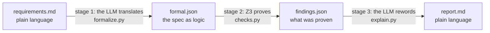
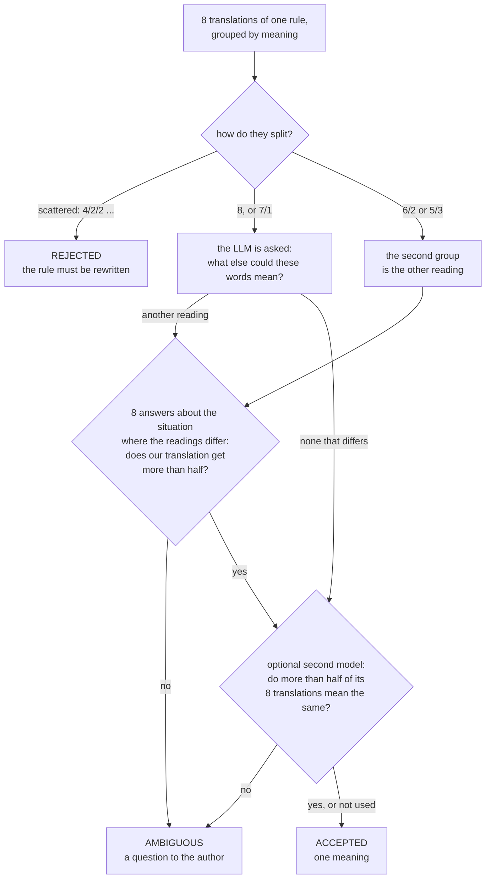

# speccheck: a guided tour


| Part | What it covers |
|---|---|
| [0](#0-the-whole-project-on-one-screen) | the whole project on one screen |
| [1](#1-background) | how to read a formula, and what the Z3 solver does |
| [2](#2-the-basic-pipeline-on-one-small-spec) | the basic pipeline, followed on a spec of five rules |
| [3](#3-four-ways-the-translation-goes-wrong-and-the-four-repairs) | the four things that go wrong, and the repair for each |
| [4](#4-how-sure-is-a-finding) | how much to trust a finding |
| [5](#5-where-we-are) | how we measure, the results, the limits, what comes next |
| [6](#6-what-to-open-next) | what to run and read, in order, and a small glossary |

---

## 0. The whole project on one screen

Requirements are written in plain language, and plain language lets mistakes
through. Three kinds matter here:

- two requirements contradict each other: one says "place the order on
  backorder", another says "never backorder";
- a case is left out: nothing says what should happen when no order was submitted;
- a sentence can be read in two ways: does "reaches 5" mean exactly 5, or 5 or more?

Usually nobody notices until the code is written. The
[Kiro blog](https://kiro.dev/blog/deep-spec-analysis/) describes a way to catch
these mistakes earlier: let a language model translate the requirements into
logic, and let a solver *prove* what is wrong with that logic. This project
rebuilds that idea as a small prototype, to understand how it works and to
measure how well it does.

The tool is called `speccheck`, and it works in three stages:



Three parties are at work, and it helps to keep them apart:

| Who | What it does | Can it be wrong?                        |
|---|---|-----------------------------------------|
| the LLM | translates the text into logic (stage 1) and puts the results into words (stage 3) | yes                                     |
| Z3, the solver | proves every conflict, gap and scenario (stage 2) | no, not about the formulas it was given |
| our Python code | decides which questions Z3 is asked, and does the counting and voting | code with tests, not formally proven :) |

That table holds the main idea of the whole project. Z3 never makes a mistake
about the formulas it is given, but those formulas were written by a language
model, and a language model does make mistakes. So most of the work, and most
of the code, deals with one question: can we trust the translation, and when
we cannot, do we say so clearly?

To give an idea of the size: about 2,400 lines of Python now, half of them comments
and prompts, one local model (Qwen3.8, 27B), and results measured on 261 versions
of small specs. The results are in part 5.

---

## 1. Background

### 1.1 How to read a formula

The formulas use a notation called SMT-LIB. It looks odd at first, because the
operator comes first, inside the parentheses:

| You see | Read it as |
|---|---|
| `(and a b)` | a and b |
| `(not a)` | not a |
| `(=> a b)` | if a then b |
| `(= x 5)` , `(>= x 5)` | x is 5 , x is 5 or more |
| `(xor a b)` | exactly one of a and b is true |

A longer formula is read from the inside out:

```
(=> (and order_submitted (not inventory_available)) order_on_backorder)
     └──────────── if this ─────────────────────┘   └── then this ──┘

"if an order is submitted and inventory is not available, the order is on backorder"
```

There is one trap, and it matters later. In logic, `(=> a b)` is true whenever
`a` is false. Think of "if it rains, I take an umbrella": on a sunny day you
have not broken that promise, whatever you carry. We will need this in 2.3.

### 1.2 What Z3 does

Z3 is a solver. You hand it some formulas, and it answers exactly one kind of
question:

> Is there a situation in which all these formulas hold?

The answer is either "yes" (the technical word is *satisfiable*), together
with one such situation, or "no" (*unsatisfiable*). That "no" is a proof: no
such situation exists.

A *situation* is simply a value for every symbol, a snapshot of the system:
`order_submitted = true, inventory_available = false`, and so on.

That is all Z3 does. Whenever the documents say that something is counted,
voted on, grouped or repeated, it is our Python code doing it, and each time
it asks Z3 this one question.

How do you prove anything with a tool that only looks for situations? You ask
it for a counterexample. If Z3 proves that no counterexample exists, the thing
you wanted to know is true. The project uses this in three forms:

| We want to know | We ask Z3 for a situation where... | If Z3 proves there is none |
|---|---|---|
| do the formulas T1 and T2 mean the same? | one holds and the other does not: `(xor T1 T2)` | they mean the same |
| does fact F follow from the facts G? | G holds and F does not: `(and G (not F))` | F follows from G |
| can the rules be obeyed in situation S? | S holds and every rule holds | they cannot: a **conflict** |

When Z3 answers "yes" instead, the situation it returns is useful too. It
becomes the concrete example shown to the person. The other documents call it
the *witness*, and the JSON files store it in a field named `when`.

---

## 2. The basic pipeline, on one small spec

We now follow one small spec through the three stages. It is the
order-processing example from the Kiro blog, in `specs/order/requirements.md`:

```
R1: WHEN an order is submitted AND inventory is available, THE Order System SHALL fulfill the order.
R2: WHEN an order is submitted AND inventory is unavailable, THE Order System SHALL place the order on backorder.
R3: THE Order System SHALL NOT place any order on backorder.
R4: WHEN an order is canceled, THE Order System SHALL refund all associated payments.
R5: WHILE an order is in a canceled-and-refunded state, THE Order System SHALL NOT fulfill the order.
```

### 2.1 Stage 1: the LLM translates

The model first decides which facts the text is about, and gives each one a
name. These named facts are the *symbols*:

```
order_submitted        yes/no    "An order has been submitted by a customer."
inventory_available    yes/no    "The inventory for the ordered items is available."
order_on_backorder     yes/no    "The order system has placed the order on backorder."
...                    (7 in all)
```

Then it writes each requirement as a *rule* with two halves: when the rule
applies (the *antecedent*) and what must be true then (the *consequent*).

| Rule | when (antecedent) | then (consequent) |
|---|---|---|
| R1 | `(and order_submitted inventory_available)` | `order_fulfilled` |
| R2 | `(and order_submitted (not inventory_available))` | `order_on_backorder` |
| R3 | `true` (always) | `(not order_on_backorder)` |
| R4 | `order_canceled` | `payments_refunded` |
| R5 | `order_canceled_and_refunded` | `(not order_fulfilled)` |

Each row means "if antecedent, then consequent". The result is saved as
`formal.json`, and that file is all the next stage ever sees.

### 2.2 Stage 2: Z3 looks for three kinds of situation

No language model is involved here. Our code asks Z3 for three kinds of
situation, and each kind becomes a finding:

| Finding | What it says | In the order spec |
|---|---|---|
| **conflict** | in this situation the rules cannot all be obeyed | an order is submitted and there is no stock: R2 says backorder it, R3 says never |
| **gap** | in this situation no rule applies | no order submitted, none canceled: what should the system do? |
| **scenario** | the rules allow this. Was it meant? | an order is fulfilled although none was submitted |

There is a fourth kind of finding, the *ambiguity*. It works differently, and
section 3.1 explains it.

### 2.3 How a conflict is found

The obvious question for Z3 is "is there a situation in which all five rules
hold?". It does not work. Z3 answers yes, and shows the situation in which no
order is submitted and none is canceled. The four rules that have a condition
demand nothing there (the umbrella on a sunny day, from 1.1), and R3 is obeyed
because nothing is on backorder. All five rules hold, and we have learned
nothing about R2 and R3.

So we do not let Z3 pick the situation. We fix it ourselves, with the "when"
part of a rule, and ask two questions:

| | What Z3 is given | Z3 answers | What that tells us |
|---|---|---|---|
| question 1 | only the "when" part of R2: `(and order_submitted (not inventory_available))` | yes | this situation can happen |
| question 2 | the same "when" part, and all five rules | no | in this situation the rules cannot all be obeyed: a **conflict** |

Adding the "when" part of a rule to the question is called *forcing the rule
to apply*. The answer to question 2 is "no" because, once an order is
submitted and there is no stock, R2 demands the backorder and R3 forbids it.

Our code asks these two questions for every rule on its own, for every pair of
rules and for every group of three. For a pair, both "when" parts are added.
Question 1 then drops the pairs that can never apply together, such as R1 and
R2: stock cannot be available and unavailable at once. The report names only
the rules that the clash needs, here R2 and R3, and not all five.

### 2.4 How a gap and a scenario are found

**A gap** is a situation in which something happens and no rule says what to
do. Our code takes each *event*, which is something that happens at one
moment, such as "an order is submitted". For each event it asks Z3: is there a
situation in which this event happens and the "when" part of every rule is
false?

| Question to Z3 | Answer | Why |
|---|---|---|
| an order is submitted, and no rule applies? | no | with stock R1 applies, without stock R2 applies |
| an order is canceled, and no rule applies? | no | R4 applies |
| no event happens, and no rule applies? | yes | nothing happened, so no rule was asked for anything |

R3 is left out of this check. It has no "when" part: it forbids something in
every situation and reacts to nothing, so it never says what to do.

The order spec has only the last gap. The report marks it "no event happens",
because it is rarely a problem: when nothing happens, a system normally just
waits. A spec with R1 and without R2 would have a real gap: "an order is
submitted, inventory is not available, and no rule applies".

**A scenario** is a situation that the rules allow, although the author may
not have meant to allow it. For each rule we ask Z3: is there a situation in
which all rules hold, this rule does *not* apply, and what it demands happens
anyway? For R1 the answer is yes:

```
order_fulfilled = true, order_submitted = false     an order is fulfilled although none was submitted
```

The rules allow this because R1 says "when an order is submitted, fulfill
it", and not "fulfill an order only when one was submitted". The tool cannot
know whether that matters, so it shows the situation and the author decides.
The reverse also exists: a situation that the rules make impossible, which the
report shows as "ruled out".

Gaps and scenarios are easy to confuse. In a gap the spec says nothing. In a
scenario the spec does decide, and the question is whether that was intended.

### 2.5 Stage 3: the LLM rewords

The findings are facts about formulas, which nobody wants to read. So the model
is asked to say each one in the words of the requirements, and to offer two
choices: keep the text as it is, or make one specific change.

> **1. Conflict: Backorder Requirement Conflict**
>
> [...] In the situation where an order is submitted but inventory is
> unavailable, R2 requires the system to place the order on backorder, while
> R3 explicitly forbids the system from placing any order on backorder.
>
> - **A) Keep as-is:** [...]
> - **B) Change:** Remove R3 entirely, or modify R3 [...]
>
> *Proven:* Requirements R2, R3 cannot all be obeyed in this situation:
> - FALSE: inventory_available
> - TRUE: order_submitted

Two things keep this stage honest. The model is told that the finding is
proven and that it may only reword it. And under each explanation the report
prints the lines marked *Proven*, which are the exact facts from Z3, so you
can compare the wording with what was actually shown.

### 2.6 Try it now

You do not need a GPU for this. The repository contains a saved `formal.json`
for the order spec, so the solver stage can run without the model. The report
then holds the proven facts, without the wording. From the project folder,
inside its `.venv`:

```
python -m speccheck specs/order/requirements.md --formal specs/order/formal.json --out out
python -m pytest tests
```

It is also worth spending five minutes with Z3 directly. Start `python` in the
project folder and paste this:

```python
import json
from speccheck.logic import Vocabulary

formal = json.load(open("specs/order/formal.json", encoding="utf-8"))
vocab = Vocabulary(formal["symbols"])                    # symbols -> Z3 variables
R = {r["id"]: vocab.rule(r) for r in formal["rules"]}    # rules   -> Z3 formulas
all_rules = [r.formula for r in R.values()]

vocab.model(all_rules)                    # a situation: all rules hold when nothing happens
situation = [R["R2"].antecedent]          # force R2 to apply
vocab.model(situation)                    # a situation: it can happen
vocab.impossible(situation + all_rules)   # True: no way to obey all rules there
```

`vocab.model` means "give me a situation", and `vocab.impossible` means "prove
there is none". The whole solver stage is built from these two calls.

---

## 3. Four ways the translation goes wrong, and the four repairs

What you have seen so far is the easy part. If the model always translated
correctly, the project would end here. It does not, and when the translation
is wrong, Z3 goes on to prove something about the wrong formulas, with
complete confidence.

Four things go wrong in practice. Each has its own repair, and each repair
leaves a visible trace in the report, so the reader can tell how far to trust
a finding:

| What goes wrong | Example | The repair | What the report shows |
|---|---|---|---|
| a sentence has two meanings, and the model silently picks one | "reaches 5": exactly 5, or 5 or more? | the ambiguity check (3.1) | an **Ambiguity**: a question to the author |
| two rules say opposite things in different words, and Z3 sees two unrelated symbols | "grant access" and "deny access" | assumed facts and links (3.2) | "Conflict (**if the assumed facts hold**)" |
| the logic has no time, only one snapshot, so conflicts appear that are not real | two events "at the same moment" | the doubtful mark (3.3) | "Conflict (**doubtful**: ...)" |
| another run picks other symbols, and gives other findings | a conflict found in one run and missed in the next | several symbol sets (3.4) | "**found with 3 of 3** symbol sets" |

The next four sections take them one by one.

### 3.1 Does a rule have only one meaning?

Take this rule from the login spec in `specs/auth_openspec`: "WHEN the number
of failed attempts on an account reaches 5 THEN the system locks the account".
Most people read it without hesitating, and yet two developers could build two
different systems from it:

```
reading A   exactly 5      (=> (= failed_attempts 5)  account_locked)
reading B   5 or more      (=> (>= failed_attempts 5) account_locked)
```

The two readings disagree in one situation only: 6 failed attempts, and the
account *not* locked. Reading A is obeyed there, because it says nothing about
6 attempts. Reading B is broken, because it demands the lock. Both parts of
the situation are needed: at 5 attempts the two readings agree, and a locked
account obeys both.

Left alone, the model picks one reading and says nothing. The tool has three
ways to notice that there are two.

1. **Sample.** The model translates the rule eight times, independently, and
   our code puts the translations that mean the same into one group. Two
   translations mean the same when Z3 proves that no situation tells them
   apart (the first row of the table in 1.2). If two or three of the eight
   form a second group, that group is a second reading. If the eight scatter
   widely (4/2/2, for example), the rule is rejected and has to be rewritten.
   The weakness of sampling is that one model tends to make the same choice
   every time. Here the eight split seven to one, which counts as agreement.

2. **Ask about a concrete case.** If sampling gave no second reading, the
   model is asked what else the words could mean. Here it proposes reading B.
   Z3 then finds the situation in which the two readings disagree, the one
   above, and the model is asked about it eight times:

   ```
   Requirement   WHEN the number of failed attempts on an account reaches 5
                 THEN the system locks the account
   Situation     the number of failed attempts is 6; the account is not locked
   Reading A     exactly 5: the requirement is obeyed in this situation
   Reading B     5 or more: the requirement is broken in this situation
   Question      do the words of the requirement support A, B, or either?
   ```

   Our translation stands only if it gets more than half of the answers. Here
   "exactly 5" got one answer and "5 or more" got six, so the rule is reported
   as ambiguous. This step is in `probe.py`.

3. **A second model (optional).** A model from another family translates the
   same rule eight times, and our code counts, with Z3, how many of these
   translations mean the same as ours. If half or fewer do, the rule is
   reported as ambiguous. The idea: two different readers translate a clear
   sentence the same way, so when they differ, the sentence is probably the
   reason.

The three ways together, as a diagram:



The report does not give a verdict on an ambiguity. It asks a question (this
is real output):

> **1. Ambiguity: Ambiguity in lock threshold**
>
> Requirement R3 states that the system locks an account when the number of
> failed attempts reaches 5, but it is unclear if this applies only when the
> count is exactly 5 or whenever it is 5 or more. [...] Which did you mean?

Until the author answers, the checks go on with reading A, so another finding
may exist only because of that choice. The solver therefore tries each
ambiguous rule once more with its other reading. In this spec the report has a
gap at "6 failed attempts, no password submitted". With reading B, R3 applies
there and the gap is gone, so the title of that gap ends with "depends on the
reading of R3".

### 3.2 Telling the solver what the words mean

Here are two more rules from the same login spec:

```
R1  "WHEN a user submits a correct password THEN the system grants access"
    (=> (and password_submitted password_correct) access_granted)

R4  "WHEN a user submits a password for a locked account THEN the system denies access"
    (=> (and password_submitted account_locked) access_denied)
```

Anyone can see the problem: what happens when someone enters the correct
password for a locked account? R1 says grant access, R4 says deny it. Z3 does
not see it. To Z3, `access_granted` and `access_denied` are two unrelated
yes/no values, and when we ask about that situation it calmly answers:

```
access_granted = true, access_denied = true        both rules obeyed, no conflict
```

What is missing is a piece of common sense that nobody wrote down: access
cannot be granted and denied at once. The repair is to let the model supply
such facts, with some care.

#### Voted facts

A *voted fact* is a piece of common sense that the model proposes and that
most of its answers agree on. It is made in four steps:

1. **The model is asked eight times** to list the statements that are always
   true because of what the symbols mean. It sees only the symbols and their
   descriptions, not the requirements, so it cannot pass off a requirement as
   a fact.
2. **Each of the eight answers is a list of facts**, and every fact is a
   sentence with its formula. For example: "The system cannot simultaneously
   grant and deny access", `(not (and access_granted access_denied))`. An
   empty list is a valid answer too.
3. **The answers vote.** Every fact in every answer is a candidate. An answer
   votes for a candidate when Z3 proves that the candidate follows from the
   facts in that answer (the second row of the table in 1.2). So answers that
   say the same thing in different words vote for the same candidate.
4. **Our code keeps a candidate that has more than half of the eight votes.**
   It is then called an *assumed fact*, and it is saved in `formal.json` with
   its votes.

This is the vote in one run of the login spec:

| Candidate | Votes | Kept? |
|---|---|---|
| access cannot be granted and denied at once | 6 of 8 | yes |
| the number of failed attempts is not negative | 6 of 8 | yes |
| a locked account grants no access | 1 of 8 | no. It says what the system should do, not what the words mean |

In the run saved in `specs/auth_openspec/`, the first two have 7 of 8 votes.

#### How the conflict search uses a fact

The conflict search of 2.3 forces pairs of rules to apply, and one pair is R1
and R4. Their two "when" parts together give the situation from above: a user
submits the correct password for a locked account. In it, as in every
situation it builds, the search asks its question twice:

| | What Z3 is given | Z3 answers | Result |
|---|---|---|---|
| search 1 | the situation and the rules | yes, with `access_granted = true` and `access_denied = true` | no conflict from the rules alone |
| search 2 | the situation, the rules and the assumed facts | no: access cannot be granted and denied at once | a **conflict**. The report says "if the assumed facts hold" and quotes the fact |

Search 1 never sees the facts, so a fact can add a conflict and can never hide
one. We learned this the hard way. Early in the project, seven of eight
answers agreed that "an order cannot be both fulfilled and canceled". That is
a business rule, not a fact about what the words mean, and at the time it made
a real conflict in the order spec disappear.

#### Links

Voted facts do not solve every case. The second example of the Kiro blog
(`specs/delete_property`) has these two requirements:

```
D2   "WHEN a Property Owner confirms deletion, THE Platform SHALL remove the
      Property record from the Platform"
     (=> deletion_confirmed property_record_removed)

D4   "THE Platform SHALL implement soft deletion to retain Property records in
      the database for audit purposes while hiding them from the user interface"
     (=> property_deleted (and property_record_retained_in_db property_hidden_from_ui))
```

D2 removes the record and D4 keeps it. Z3 does not see the clash, because
`property_record_removed` and `property_record_retained_in_db` are two
unrelated symbols: a record can be removed and retained at once. No fact was
voted to connect them, because the symbols alone do not settle it: a record
"removed from the Platform" could still be in the database.

A *link* takes the connection from the text of D2 instead. It is made in four
steps:

1. **Our code picks D2**, because what D2 demands is written with a symbol
   that no other rule uses, `property_record_removed`.
2. **The model translates D2 again, eight times, without that symbol.** It may
   use only the symbols of D2's own "when" part and the symbols with which
   the other rules say what they demand, such as
   `property_record_retained_in_db` from D4. It may also answer that these
   symbols cannot express D2.
3. **Our code groups the eight answers by meaning**, as in 3.1. Here all eight
   said the same: `(=> deletion_confirmed (not property_record_retained_in_db))`,
   "when the owner confirms the deletion, the record is not retained in the
   database". A meaning with more than half of the answers becomes the link.
4. **The link is tested before it is used**, because "remove" could still
   mean "hide". The model is shown the text of D2 and the one situation that
   would prove the link wrong: the owner has confirmed the deletion, and the
   record is still in the database. It is asked eight times whether this
   could be true in a system that does everything D2 demands. The link is
   kept only if more than half of the answers say "impossible". For D2 all
   eight did.

A link is used like a voted fact, only in search 2. With it, Z3 sees that D2
means "not retained" where D4 says "retained", and the conflict between D2 and
D4 is found. The report says "if the assumed facts hold" and quotes the link,
so the reader can judge whether "remove" really means that.

### 3.3 Marking the conflicts that are probably not real

The formulas describe one snapshot of the system, with no "before" and no
"after". This produces conflicts that are correct as logic and meaningless in
practice. They come in two shapes.

The first shape is two events in the same instant. Take a newsletter spec:

```
rule 1      "WHEN a visitor submits the signup form THEN the system sends no email ..."
rule 2      "WHEN a subscriber changes the email address THEN the system sends a confirmation email"

situation   visitor_signed_up = true, address_changed = true
            "no email" against "an email": a conflict
```

Z3 is free to let both events happen in one snapshot, but nobody writes
requirements for two unrelated events in the same instant. So when the model
reads the spec, it also names the event each rule reacts to, the rule's
*trigger*. A conflict between rules with different triggers is marked as
doubtful.

The second shape is a situation that cannot happen. Take a booking spec:

```
"cancels at least 24 hours before": no fee        "less than 24 hours before": a late fee

situation   at_least_24h = true, less_than_24h = true     no fee and a late fee: a conflict
fact        (not (and at_least_24h less_than_24h))        this situation cannot happen
```

The two conditions became two separate yes/no symbols, so Z3 can make both
true. A conflict whose situation the assumed facts rule out is marked as
doubtful too, and so is a gap (5.2).

In both cases the conflict stays in the report, with the word "doubtful" and
the reason. It is marked and not deleted because the mark is itself a guess:
in the evaluation it also landed, a few times, on real conflicts that we had
planted.

### 3.4 Do the findings depend on the symbols?

Everything starts from the symbols that the model picks in its very first
step, and it does not always pick the same ones. A conflict found in one run
can be missed in the next, simply because the second run described the facts
differently.

The answer is to translate several times and count. With `--symbol-sets 3` the
spec is formalized three times, each time with its own symbols, and every
finding says how many of the three found it:

> **3. Conflict (found with 3 of 3 symbol sets): Conflict between removal and retention**

In the evaluation, the findings that most symbol sets agreed on were never wrong.

### 3.5 Recap

Seven steps, all in `formalize.py`. In a pipeline diagram above they
look arbitrary. Now each one has a reason:

| Step | What happens | Why it is there |
|---|---|---|
| 1 read | one LLM call lists the rules, picks the symbols, and names each rule's trigger | everything starts here; the triggers serve 3.3 |
| 2 sample | each rule is translated 8 times | 3.1 |
| 3 cluster | the 8 translations are grouped by meaning, with Z3 | 3.1 |
| 4 facts | 8 answers propose facts, and they vote, with Z3 | 3.2 |
| 5 links | a rule with a symbol of its own is said again in the other rules' terms | 3.2 |
| 6 probe | questions about concrete situations (`probe.py`) | 3.1 and 3.2 |
| 7 second | optional: a second model translates every rule | 3.1 |

---

## 4. How sure is a finding?

Each repair leaves its mark in the title of a finding, so the title tells you
how much weight the finding carries:

| The title says | What it means | How far to trust it |
|---|---|---|
| "Conflict: ..." | proven from the rules alone | a lot. It is wrong only if the translation is wrong |
| "Conflict (if the assumed facts hold): ..." | proven only with a guessed fact, which the report quotes | read the quoted fact and judge it yourself |
| "Conflict (doubtful: ...)" | proven, but it has the shape of the artefacts in 3.3 | little. In the evaluation nearly all of these were false alarms |
| "... (depends on the reading of R3)" | proven with the first reading of R3, which is ambiguous; gone with its other reading | answer the question about R3 first |
| "... (found with k of K symbol sets)" | k of the K formalizations found it | the higher k, the better |
| "Ambiguity: ..." | not a proof, a question to the author | a fair question, though some are asked about clear rules |
| "Gap: ..." | proven: an event happens and no rule applies | certain. Ask yourself whether that case was left out on purpose |
| "Gap (doubtful: ...)" | proven, but the assumed facts say its situation cannot happen (5.2) | little: usually two symbols for one yes/no question |
| "Gap (no event happens): ..." | proven: nothing happens, and no rule applies (2.4) | certain, but rarely something to fix. Almost every spec has this gap, so it is shown once, after the other gaps |
| "Scenario, allowed: ..." or "Scenario, ruled out: ..." | proven: the rules allow this situation, or make it impossible (2.4) | the proof is certain. Which scenarios are shown is the model's choice, and whether one is a problem is for you, the author, to decide |

If you keep one thing from this part: a finding is a proof about
`formal.json`, not a proof about what the author meant. When a finding looks
wrong, open `formal.json` and read how that rule was translated. Most of the
time the explanation is there.

---

## 5. Where we are

### 5.1 How we measure

To say how good the tool is, we need specs for which the right answer is
known, so we make them ourselves. We write a small clean spec, and then
versions of it with one defect added by hand, a *planted* defect:

```
experiments/sets/eval4/lockers_clean       5 rules, no defect
experiments/sets/eval4/lockers_overlap     one rule added: "WHEN the locker is in maintenance mode
                                           THEN the system opens no compartment". It must clash
                                           with rules 1 and 3, which both open a compartment.
experiments/sets/eval4/lockers_ambiguity1  rule 5 reworded from "for more than 72 hours"
                                           to "is still in its compartment after 72 hours"
```

A set has six specs on six subjects, half in Kiro's EARS style and half in the
OpenSpec style. Every spec comes in three to five versions:

| Version | What is changed | What the tool must report |
|---|---|---|
| `clean` | nothing | no conflict |
| `direct` | one rule added that plainly contradicts an existing one | that conflict |
| `overlap` | one rule added that clashes with an existing one only when both conditions hold | that conflict |
| `ambiguity1`, `ambiguity2` | one rule reworded so that it has two readings | that rule, as ambiguous |
| `gap` (from `eval8` on) | one of two complementary rules removed | a gap for the case left open |

Each version is a folder with two files: `spec.md`, which the tool reads, and
`expected.json`, which holds the answer. For `lockers_overlap` it says
`{"conflicts": [[1, 6], [3, 6]]}`: rule 6 clashes with rule 1 and with rule 3.
There are ten sets, `eval` to `eval10`, with 261 versions in all.

Two more terms. A conflict reported on a clean spec is a *false alarm*. And
because the model answers a little differently each time, every version is run
three times, so all the numbers are counts of runs.

Why so many sets? It is tempting to tune the prompts until the test specs come
out right, and then the result means nothing. So each set is written before a
design change and used once, like an exam. The research notes call it a
*held-out set*. After its results have been read it only counts as practice
material, and the next change needs a new set.

### 5.2 The results

```
planted conflicts found, on 10 sets the design had not seen

eval    44/48   ██████████████████░░   92%
eval2   31/36   █████████████████░░░   86%
eval3   15/21   ██████████████░░░░░░   71%
eval4   21/21   ████████████████████  100%
eval5   11/18   ████████████░░░░░░░░   61%
eval6   15/18   █████████████████░░░   83%
eval7   13/18   ██████████████░░░░░░   72%
eval8   18/21   █████████████████░░░   86%
eval9   18/18   ████████████████████  100%
eval10  18/18   ████████████████████  100%
```

| Question | Answer |
|---|---|
| Kiro's first example (`order`) | its 2 conflicts and its gap were found in 190 of 190 runs |
| Kiro's second example (`delete_property`) | found in 3 of the last 3 runs. It was the hard one: 1 of 40 before links existed |
| planted conflicts | 61% to 100% found (the chart above) |
| false alarms | at most 1 in 18 clean runs, when doubtful conflicts are set aside. In `eval9`, 2 runs found a conflict that is real: we wrote it into a clean spec by mistake |
| planted ambiguities, one model | about half (14 to 20 of 36), but 7 of 36 on `eval10` |
| planted ambiguities, with the second model | 30 and 32 of 36, at the price of up to one extra question per spec |
| how much assumed facts and links matter | a great deal: without them `eval8` gives 9 of 21, with them 18 |
| planted gaps (`eval8` to `eval10`) | 18 of 18 found in each, now that the question is asked once for each event; before, 0 of 18 |
| false gaps (`eval8` to `eval10`) | in 4, 3 and 5 of 18 runs on clean specs. Explained below |
| longer specs, 30 and 100 requirements | they went as well as the small ones. Explained below |

**The false gaps.** A clean spec in `eval8` covers both cases of an event, for
example "a resident books a time slot AND the slot is free" and "... AND the
slot is taken". Nothing is left open, so a gap for that event is a false
alarm. The tool reported one in 4 of the 18 runs on clean specs, always for
the same reason: the model had made two symbols, `slot_is_free` and
`slot_is_taken`, and to Z3 a slot can then be neither free nor taken. With one
symbol, and "taken" written as `(not slot_is_free)`, the false gap does not
appear. A voted fact "the slot is free or taken" rules that situation out, and
then the gap is marked doubtful. But the model rarely proposes such a fact:
only 2 of 13 false gaps were marked (`eval8` to `eval10`). This is a known
limit.

**Longer specs.** All the specs counted above have at most six requirements.
To see what a longer document does, we wrote two more, each in four versions
(clean, direct, overlap, gap) and run three times:

| | 30 requirements, a campsite (`experiments/sets/size`) | 100 requirements, a ferry line (`experiments/sets/size2`) |
|---|---|---|
| planted conflicts | 6 of 6 | 6 of 6 |
| planted gap | 3 of 3 | 3 of 3 |
| clean version | no conflict | one false alarm in 3 runs |
| solver stage, one run | under a second | 35 seconds |

At 100 requirements the read step's answer, which copies every requirement
and lists every symbol, is about 16,800 tokens. The model is allowed 24,576,
enough for about 140 requirements; beyond that the read step would fail. And
the optional second model cannot be used yet on a spec this long: its server
has too little room for a prompt with some 200 symbols. These are two
documents, so a first sign, not a measurement.

### 5.3 The goals

The project has five goals. This is where each one stands:

| Goal                                                      | Status |
|-----------------------------------------------------------|---|
| G1: a minimal working prototype of Kiro's formal analysis | done |
| G2: it works on any spec, in any format                   | partly: 2 formats and 51 specs. A whole OpenSpec project is still missing (see 5.6) |
| G3: only the formal part                                  | done: an LLM review of the text was built, measured, and switched off |

### 5.4 What does not work yet

| Limit | Example |
|---|---|
| "remove" against "keep" is missed in about half of the cases (found in 10 of 21 runs) | "delete the listing" against "keep every listing for seven years". This is the main cause of missed conflicts, and it is explained below the table |
| one model finds only half of the ambiguities | it is confident where a person would stop and ask |
| a fact or a link can be wrong, even with a majority behind it | which is why the report quotes every one that a conflict depends on |
| there is no time | "then", "after" and "until" are not modelled: the logic is one snapshot |
| the evaluation is small | the specs were written by us, and there is one main model |

**"Remove" against "keep", on a real case.** One of the planted conflicts
(`experiments/sets/eval6/auctions_direct`) is between these two requirements.
Under each is the translation the model gave it:

```
A4   "WHEN a seller withdraws an item, THE Auction System SHALL delete the listing
      and notify the bidders."
     (=> item_withdrawn (and listing_deleted bidders_notified))

A6   "THE Auction System SHALL keep every listing for seven years for tax audits."
     (= listing_retention_years 7)
```

A person sees the clash: a listing that is deleted on withdrawal is not kept
for seven years. Z3 cannot see it, because the model wrote the two rules about
two unrelated things. `listing_deleted` is a yes/no fact about a listing, and
`listing_retention_years` is a number, a setting of the system. Both can hold
at once (the listing is deleted, the setting is 7), so no conflict is found.
The link step of 3.2 does not help either: asked to say "delete the listing"
with the symbols of the other rules, the model has only the number of years to
work with, and it answers that this cannot be expressed.

### 5.5 What we tried and dropped

Some of the most useful lessons came from things that did not work. Three of
them explain decisions you will meet in the code:

| What we tried | What happened |
|---|---|
| treating facts as plain truths | a wrong fact with 7 of 8 votes hid a real conflict, so facts may now only add findings |
| an LLM review of the text (`refine.py`) | it finds `delete_property` every time and misses two conflicts that the solver finds. It is a judgement and not a proof, so it is switched off (`--review`): this project is about the formal check |
| fixing "remove" against "keep" with one more sentence in the prompt | no conflict was gained and a rule was lost. The details are below the table |

**The sentence we tried for "remove" against "keep".** The symbols are picked
by the first prompt, `READ_SYSTEM` in `formalize.py`. It already contains this
sentence:

> Opposites share one symbol too: "unavailable" is "not available".

We added one more, right after it:

> Removing something and keeping it are such opposites: "delete the email" and
> "keep every email for a year" are both about email_stored (plus the email's
> age for "a year").

The hope was that A4 and A6 from 5.4 would then be written about one fact,
whether the listing is stored. Two things happened instead:

- A4 kept its own symbol, `listing_deleted`, so the conflict was still missed
  in 3 of 3 runs.
- A6 was now written about a stored listing and its age, but its eight
  translations disagreed: `(=> (< listing_age_years 7) listing_stored)`,
  `(and listing_stored (>= listing_age_years 7))` and others. A rule whose
  translations scatter like that is rejected (3.1) and takes no part in any
  check.

So nothing was gained and a rule was lost, and the sentence was taken out
again. This is experiment T14 in research_log.md. A real repair would need the
model to compare two requirements and judge whether they clash. That is an LLM
judgement and not a proof, which this project leaves out on purpose.

The full list is in research.md, section 5.

### 5.6 What is next

1. **Check a change against the specs that already exist.** A real OpenSpec
   project has existing specs and a change on top of them. This is the
   recommended next step, and it was postponed on purpose.
2. **A larger evaluation**, with another main model and specs we did not
   write. All ten sets have been used, so an eleventh has to be written first.
3. **The choice of symbols**, which is where the remaining misses come from.

---

## 6. What to open next

Start by running the commands of 2.6. Then open one spec in its four forms,
side by side, and follow a single rule through them:

```
specs/order/requirements.md   the text
specs/order/formal.json       the logic              (stage 1)
specs/order/findings.json     what was proven        (stage 2)
specs/order/report.md         the plain language     (stage 3)
```

After that, `specs/auth_openspec/` has the ambiguity of 3.1 and the assumed
fact of 3.2. For the `delete_property` example, open
`experiments/examples/delete_property_links/`, a run with three symbol sets
that shows the conflict of 3.2 and 3.4. Be aware that the run saved in
`specs/delete_property/` is one of the runs that *miss* that conflict: its D4
was translated in four different ways and rejected.

Then the documents:

| File | What it gives you | When to read it |
|---|---|---|
| [README.md](README.md) | the same story in short form, with more real output, and how to run the tool with the LLM | next |
| [plan.md](plan.md) | section 5 has the exact rule behind each decision, section 6 every JSON field | while you read the code |
| [research.md](research.md) | every result, with its numbers | when you want to know what was measured |
| [research_log.md](research_log.md) | the archive: every experiment in the order it happened | only for writing the paper |

Then the code. plan.md lists the files in pipeline order. For a first reading
it is easier to take `checks.py` before `formalize.py`, because it is the part
that section 2 described:

| File | Lines | What to look for |
|---|---|---|
| `speccheck/llm.py` | 60 | one function, `ask`: a prompt goes in, N answers come out as JSON |
| `speccheck/logic.py` | 250 | `model` and `impossible`, the two questions for Z3 (1.2), and `same_meaning` |
| `speccheck/checks.py` | 690 | `_search` forces rules to apply (2.3); `find_conflicts` runs the two searches (3.2); `_try_other_readings` (3.1); then `find_gaps` and `find_scenarios` (2.4) |
| `speccheck/formalize.py` | 680 | the seven steps of 3.5. The prompts at the top show what the LLM is asked |
| `speccheck/probe.py` | 430 | the questions about concrete situations (3.1 and 3.2) |
| `speccheck/explain.py` | 350 | `evidence` writes the *Proven* lines; the wording prompt is above it |
| `speccheck/cli.py` | 110 | the three stages, called one after the other |

About half of each file is comments, docstrings and prompts.

The folders:

```
speccheck/          the tool (the 7 files above; refine.py is the review that is switched off)
specs/              3 small specs the prompts were developed on, with their saved output
tests/              44 tests that need no LLM
experiments/
  sets/             the 10 evaluation sets, eval to eval10 (261 spec versions), and two long specs
  results/          every experiment: the raw data (.json) and its tables (.md)
  examples/         saved runs that the documents quote
  evaluate.py       runs the pipeline on a set and scores it
  make_eval.py      writes the evaluation sets
  slurm/            starts the model servers on the cluster
```

### A small glossary

| Term | In one line | Example |
|---|---|---|
| symbol | a named variable for one fact | `inventory_available` |
| situation | a value for every symbol: one snapshot | `order_submitted = true, inventory_available = false` |
| rule | one requirement in logic: if antecedent, then consequent | R2 in 2.1 |
| antecedent, consequent | when the rule applies, and what must hold then | `order_canceled`, `payments_refunded` |
| translation | one LLM answer that writes a rule in logic | `(=> (= failed_attempts 5) account_locked)` |
| reading | one meaning of the words | "exactly 5" and "5 or more" are two readings |
| sample | one of 8 independent LLM answers to the same question | the 8 translations of R3 |
| witness (`when`) | the situation Z3 gives as its example | "an order is submitted, no stock" |
| assumed fact | true by the meaning of the words, guessed by the LLM, may only add findings | "access cannot be granted and denied" |
| link | an assumed fact that says one rule in the other rules' terms | "removed means not retained" |
| event, trigger | something that happens at one moment; the event a rule reacts to | `order_submitted` |
| doubtful | a proven conflict that looks like an artefact | two events at once |
| symbol set | the symbols of one formalization | `--symbol-sets 3` |
| formal model | one `formal.json`: symbols, assumed facts and rules | `specs/order/formal.json` |
