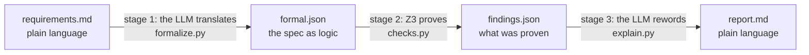
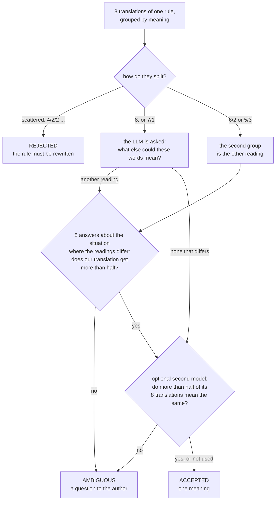
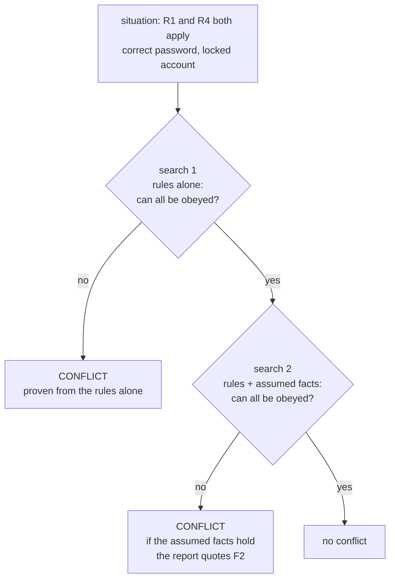

# speccheck: a guided tour

If you are new to this project, start here. The README is dense. This guide
goes through the same ideas slowly, one at a time, and every idea starts from
an example. It takes about half an hour, and at the end it tells you what to
open next.

| Part | What it covers |
|---|---|
| [0](#0-the-whole-project-on-one-screen) | the whole project on one screen |
| [1](#1-two-things-to-learn-first) | how to read a formula, and what the Z3 solver does |
| [2](#2-the-basic-pipeline-on-one-small-spec) | the basic pipeline, followed on a spec of five rules |
| [3](#3-four-ways-the-translation-goes-wrong-and-the-four-repairs) | the four things that go wrong, and the repair for each |
| [4](#4-how-sure-is-a-finding) | how much to trust a finding |
| [5](#5-where-we-are) | how we measure, the results, the limits, what comes next |
| [6](#6-what-to-open-next) | what to run and read, in order, and a small glossary |

---

## 0. The whole project on one screen

Requirements are written in plain language, and plain language lets mistakes
through. Three kinds matter here:

- two requirements contradict each other: one says "place the order on
  backorder", another says "never backorder";
- a case is left out: nothing says what should happen when no order was submitted;
- a sentence can be read in two ways: does "reaches 5" mean exactly 5, or 5 or more?

Usually nobody notices until the code is written. The
[Kiro blog](https://kiro.dev/blog/deep-spec-analysis/) describes a way to catch
these mistakes earlier: let a language model translate the requirements into
logic, and let a solver *prove* what is wrong with that logic. This project
rebuilds that idea as a small prototype, to understand how it works and to
measure how well it does.

The tool is called `speccheck`, and it works in three stages:



Three parties are at work, and it helps to keep them apart:

| Who | What it does | Can it be wrong? |
|---|---|---|
| the LLM | translates the text into logic (stage 1) and puts the results into words (stage 3) | yes |
| Z3, the solver | proves every conflict, gap and scenario (stage 2) | no, not about the formulas it was given |
| our Python code | decides which questions Z3 is asked, and does the counting and voting | it is ordinary code, with 42 tests |

That table holds the main idea of the whole project. Z3 never makes a mistake
about the formulas it is given, but those formulas were written by a language
model, and a language model does make mistakes. So most of the work, and most
of the code, deals with one question: can we trust the translation, and when
we cannot, do we say so clearly?

To give an idea of the size: about 2,400 lines of Python, half of them comments
and prompts, one local model (Qwen, 27B), and results measured on 171 versions
of small specs. The results are in part 5.

---

## 1. Two things to learn first

Everything later is written in formulas, and talks about what the solver
"proves". Both are simple once you have seen them, so we start there.

### 1.1 How to read a formula

The formulas use a notation called SMT-LIB. It looks odd at first, because the
operator comes first, inside the parentheses:

| You see | Read it as |
|---|---|
| `(and a b)` | a and b |
| `(not a)` | not a |
| `(=> a b)` | if a then b |
| `(= x 5)` , `(>= x 5)` | x is 5 , x is 5 or more |
| `(xor a b)` | exactly one of a and b is true |

A longer formula is read from the inside out:

```
(=> (and order_submitted (not inventory_available)) order_on_backorder)
     └──────────── if this ─────────────────────┘   └── then this ──┘

"if an order is submitted and inventory is not available, the order is on backorder"
```

There is one trap, and it matters later. In logic, `(=> a b)` is true whenever
`a` is false. Think of "if it rains, I take an umbrella": on a sunny day you
have not broken that promise, whatever you carry. We will need this in 2.3.

### 1.2 What Z3 does

Z3 is a solver. You hand it some formulas, and it answers exactly one kind of
question:

> Is there a situation in which all these formulas hold?

The answer is either "yes" (the technical word is *satisfiable*), together
with one such situation, or "no" (*unsatisfiable*). That "no" is a proof: no
such situation exists.

A *situation* is simply a value for every symbol, a snapshot of the system:
`order_submitted = true, inventory_available = false`, and so on.

That is all Z3 does. Whenever the documents say that something is counted,
voted on, grouped or repeated, it is our Python code doing it, and each time
it asks Z3 this one question.

How do you prove anything with a tool that only looks for situations? You ask
it for a counterexample. If Z3 proves that no counterexample exists, the thing
you wanted to know is true. The project uses this in three forms:

| We want to know | We ask Z3 for a situation where... | If Z3 proves there is none |
|---|---|---|
| do the formulas T1 and T2 mean the same? | one holds and the other does not: `(xor T1 T2)` | they mean the same |
| does fact F follow from the facts G? | G holds and F does not: `(and G (not F))` | F follows from G |
| can the rules be obeyed in situation S? | S holds and every rule holds | they cannot: a **conflict** |

When Z3 answers "yes" instead, the situation it returns is useful too. It
becomes the concrete example shown to the person. The other documents call it
the *witness*, and the JSON files store it in a field named `when`.

---

## 2. The basic pipeline, on one small spec

We now follow one small spec through the three stages. It is the
order-processing example from the Kiro blog, in `specs/order/requirements.md`:

```
R1: WHEN an order is submitted AND inventory is available, THE Order System SHALL fulfill the order.
R2: WHEN an order is submitted AND inventory is unavailable, THE Order System SHALL place the order on backorder.
R3: THE Order System SHALL NOT place any order on backorder.
R4: WHEN an order is canceled, THE Order System SHALL refund all associated payments.
R5: WHILE an order is in a canceled-and-refunded state, THE Order System SHALL NOT fulfill the order.
```

### 2.1 Stage 1: the LLM translates

The model first decides which facts the text is about, and gives each one a
name. These named facts are the *symbols*:

```
order_submitted        yes/no    "An order has been submitted by a customer."
inventory_available    yes/no    "The inventory for the ordered items is available."
order_on_backorder     yes/no    "The order system has placed the order on backorder."
...                    (7 in all)
```

Then it writes each requirement as a *rule* with two halves: when the rule
applies (the *antecedent*) and what must be true then (the *consequent*).

| Rule | when (antecedent) | then (consequent) |
|---|---|---|
| R1 | `(and order_submitted inventory_available)` | `order_fulfilled` |
| R2 | `(and order_submitted (not inventory_available))` | `order_on_backorder` |
| R3 | `true` (always) | `(not order_on_backorder)` |
| R4 | `order_canceled` | `payments_refunded` |
| R5 | `order_canceled_and_refunded` | `(not order_fulfilled)` |

Each row means "if antecedent, then consequent". The result is saved as
`formal.json`, and that file is all the next stage ever sees.

### 2.2 Stage 2: Z3 looks for three kinds of situation

No language model is involved here. Our code asks Z3 for three kinds of
situation, and each kind becomes a finding:

| Finding | What it says | In the order spec |
|---|---|---|
| **conflict** | in this situation the rules cannot all be obeyed | an order is submitted and there is no stock: R2 says backorder it, R3 says never |
| **gap** | in this situation no rule applies | no order submitted, none canceled: what should the system do? |
| **scenario** | the rules allow this. Was it meant? | an order is fulfilled although none was submitted |

There is a fourth kind of finding, the *ambiguity*. It works differently, and
section 3.1 explains it.

### 2.3 Why the conflict check forces rules to apply

This is the first idea that takes a moment to get.

The obvious question to ask Z3 would be "can all five rules hold together?".
It answers yes, and shows this situation:

```
order_submitted = false, order_canceled = false, everything else false
```

Nothing is happening, so every "if ... then" rule is obeyed, exactly as with
the umbrella on a sunny day. The answer is correct, and it tells us nothing.

So the check does something else. It takes a rule (then every pair of rules,
then every group of three), *forces* it to apply, and asks whether all the
rules can still be obeyed:

```
1. can R2 apply?                       (and order_submitted (not inventory_available))
   Z3: yes                             so the situation can happen

2. in that situation, can all          the situation, together with R1 ... R5
   rules be obeyed?
   Z3: no, proven                      a CONFLICT
```

Why is the answer "no"? Once an order is submitted and there is no stock, the
only thing left to decide is whether the order goes on backorder, and both
choices break a rule:

| `order_on_backorder` | R2 "backorder it" | R3 "never backorder" |
|---|---|---|
| true | obeyed | **broken** |
| false | **broken** | obeyed |

Z3 also reports which rules it needed to reach the contradiction, here R2 and
R3. Our code then tries to drop each of them in turn, so that the set it
reports is as small as it can be.

The other two findings come from the same kind of question:

```
gap        a situation where NO rule applies
           (and (not A1) (not A2) (not A4) (not A5))        A = antecedent; R3 always
           Z3: yes, for example order_submitted = false,    applies, so it is left out
                                order_canceled = false, ...

scenario   all rules hold, R1 does NOT apply, and R1's outcome happens anyway
           Z3: yes, for example order_fulfilled = true, order_submitted = false
           It is allowed because R1 says "when", not "only when".
```

The gap search is in fact a little more careful than this. A gap in which
nothing happens says little, so the question is asked once for each event:
"an order is submitted, and no rule applies?" In the order spec every event is
covered, so the only gap left is the one with no event, and the report marks
it "no event happens".

Gaps and scenarios are easy to confuse. A gap is a situation the spec says
nothing about. A scenario is something the spec does decide, by allowing it or
by making it impossible, and the question for the author is whether that was
intended.

### 2.4 Stage 3: the LLM rewords

The findings are facts about formulas, which nobody wants to read. So the model
is asked to say each one in the words of the requirements, and to offer two
choices: keep the text as it is, or make one specific change.

> **1. Conflict: Backorder Requirement Conflict**
>
> [...] In the situation where an order is submitted but inventory is
> unavailable, R2 requires the system to place the order on backorder, while
> R3 explicitly forbids the system from placing any order on backorder.
>
> - **A) Keep as-is:** [...]
> - **B) Change:** Remove R3 or modify it [...]
>
> *Proven:* Requirements R2, R3 cannot all be obeyed in this situation:
> - FALSE: inventory_available
> - TRUE: order_submitted

Two things keep this stage honest. The model is told that the finding is
proven and that it may only reword it. And under each explanation the report
prints the lines marked *Proven*, which are the exact facts from Z3, so you
can compare the wording with what was actually shown.

### 2.5 Try it now

You do not need a GPU for this. The repository contains a saved `formal.json`
for the order spec, so the solver stage can run without the model. The report
then holds the proven facts, without the wording. From the project folder,
inside its `.venv`:

```
python -m speccheck specs/order/requirements.md --formal specs/order/formal.json --out out
python -m pytest tests
```

It is also worth spending five minutes with Z3 directly. Start `python` in the
project folder and paste this:

```python
import json
from speccheck.logic import Vocabulary

formal = json.load(open("specs/order/formal.json", encoding="utf-8"))
vocab = Vocabulary(formal["symbols"])                    # symbols -> Z3 variables
R = {r["id"]: vocab.rule(r) for r in formal["rules"]}    # rules   -> Z3 formulas
all_rules = [r.formula for r in R.values()]

vocab.model(all_rules)                    # a situation: all rules hold when nothing happens
situation = [R["R2"].antecedent]          # force R2 to apply
vocab.model(situation)                    # a situation: it can happen
vocab.impossible(situation + all_rules)   # True: no way to obey all rules there
```

`vocab.model` means "give me a situation", and `vocab.impossible` means "prove
there is none". The whole solver stage is built from these two calls.

---

## 3. Four ways the translation goes wrong, and the four repairs

What you have seen so far is the easy part. If the model always translated
correctly, the project would end here. It does not, and when the translation
is wrong, Z3 goes on to prove something about the wrong formulas, with
complete confidence.

Four things go wrong in practice. Each has its own repair, and each repair
leaves a visible trace in the report, so the reader can tell how far to trust
a finding:

| What goes wrong | Example | The repair | What the report shows |
|---|---|---|---|
| a sentence has two meanings, and the model silently picks one | "reaches 5": exactly 5, or 5 or more? | the ambiguity check (3.1) | an **Ambiguity**: a question to the author |
| two rules say opposite things in different words, and Z3 sees two unrelated symbols | "grant access" and "deny access" | assumed facts and links (3.2) | "Conflict (**if the assumed facts hold**)" |
| the logic has no time, only one snapshot, so conflicts appear that are not real | two events "at the same moment" | the doubtful mark (3.3) | "Conflict (**doubtful**: ...)" |
| another run picks other symbols, and gives other findings | a conflict found in one run and missed in the next | several symbol sets (3.4) | "**found with 3 of 3** symbol sets" |

The next four sections take them one by one.

### 3.1 Does a rule have only one meaning?

Take this rule from the login spec in `specs/auth_openspec`: "WHEN the number
of failed attempts on an account reaches 5 THEN the system locks the account".
Most people read it without hesitating, and yet two developers could build two
different systems from it:

```
reading A   exactly 5      (=> (= failed_attempts 5)  account_locked)
reading B   5 or more      (=> (>= failed_attempts 5) account_locked)

They differ at 6 failed attempts with the account not locked (Z3 finds this case):
    A: fine, the rule says nothing about 6          B: broken
```

Left alone, the model picks one of these readings and says nothing. What we
want is for the tool to notice that there are two, and to ask the author. It
has three ways to notice, and each one catches cases the one before misses.



*The first way is to sample.* The model translates the rule eight times,
independently, and our code puts the eight translations into groups that mean
the same. Two translations go into the same group when Z3 proves that no
situation tells them apart, which is the first row of the table in 1.2. If the
eight split into two camps, we have found two readings. The weakness is that
one model tends to make the same choice every time. In the saved run of this
spec the eight translations split seven to one, which counts as agreement.

*The second way is to ask about a concrete case.* The model is asked what else
the words could mean, and it comes up with reading B. Z3 then finds a
situation in which A and B differ: six failed attempts, account not locked.
Now the model is shown the rule, both readings and that one situation, eight
times, and is asked whether the words support A, B, or either. Our translation
stands only if it gets more than half of the answers. In the saved run, A got
one answer and B got six, so the rule was reported as ambiguous. This step
lives in `probe.py`.

*The third way is optional: a second model.* A model from a different family
translates the rule eight times as well. If no more than half of its
translations mean the same as ours, the rule is reported as ambiguous. Where
the words really are unclear, a second reader hesitates or picks the other
reading, and that is exactly the signal we are after.

Whichever way finds it, the report does not give a verdict. It asks a question
(this is real output):

> **1. Ambiguity: Ambiguity in lock threshold**
>
> Requirement R3 is unclear about whether the account should be locked when
> the failed attempt count is exactly 5 or when it is 5 or more. [...] Which
> did you mean?

One consequence is easy to overlook. Until the author answers, the checks go
on with reading A, so some of the other findings may exist only because of
that choice. The solver therefore tries each ambiguous rule once more with
its other reading. In this spec the report has a gap at "6 failed attempts, no
password submitted". With reading B, R3 applies there and the gap is gone, so
the gap is reported as "Gap (depends on the reading of R3)". The ambiguity
itself lists what its other reading changes, and the ambiguities that change
something are shown first.

### 3.2 Telling the solver what the words mean

Here are two more rules from the same login spec:

```
R1  "WHEN a user submits a correct password THEN the system grants access"
    (=> (and password_submitted password_correct) access_granted)

R4  "WHEN a user submits a password for a locked account THEN the system denies access"
    (=> (and password_submitted account_locked) access_denied)
```

Anyone can see the problem: what happens when someone enters the correct
password for a locked account? R1 says grant access, R4 says deny it. Z3 does
not see it. To Z3, `access_granted` and `access_denied` are two unrelated
yes/no values, and when we ask about that situation it calmly answers:

```
access_granted = true, access_denied = true        both rules obeyed, no conflict
```

What is missing is a piece of common sense that nobody wrote down: access
cannot be granted and denied at once. The repair is to let the model supply
such facts, with some care.

#### Voted facts

The model is shown only the list of symbols with their descriptions. It does
not see the requirements, so it cannot dress up a requirement as a fact. It is
asked for statements that are true purely because of what the symbols mean,
and it is asked eight times. One of its answers:

```
F2   "The system cannot grant access and deny access simultaneously."
     (not (and access_granted access_denied))
```

Then the eight answers vote. They rarely use the same words (another answer
says "if access is granted, it is not denied"), so the vote is done by logic
and not by comparing text: an answer supports F2 when Z3 proves that F2
follows from the facts in that answer. Seven of the eight answers supported
F2. A fact needs more than half, so F2 was kept.

Finally, the conflict search runs twice:



The order of the two searches is the important part, and it comes from a
mistake made early in the project. In one experiment, seven of eight answers
agreed that "an order cannot be both fulfilled and canceled". That sounds
reasonable, but it is a business rule, not a fact about what the words mean.
At that time facts were treated as plain truths, and this one made a real
conflict in the order spec disappear. Since then the first search never sees
the facts at all. A fact can add a conflict, and the report then says "if the
assumed facts hold" and quotes the fact. It can never take a conflict away.

#### Links

Voted facts do not solve every case. In the second example of the Kiro blog
(`specs/delete_property`), one rule says the platform shall "remove the
Property record" and another says it shall "retain Property records in the
database":

```
D2:  deletion_confirmed ──► property_record_removed          no other rule uses this symbol
                                 │
                                 │  link, 8 of 8 answers: "removed" means "not retained"
                                 ▼
D4:  (its condition) ─────► property_record_retained_in_db   the clash, now visible to Z3
```

The model gave "removed" a symbol of its own, which no other rule uses, and
described it kindly, as something like "removed from the active data". With
that description, no fact connects it to "retained".

The repair is to ask a different question. A rule whose outcome uses a symbol
that no other rule uses is translated eight more times, and this time the
model may use only the outcomes of the other rules. Made to say "remove the
record" in those terms, all eight answers said the same thing: the record is
not retained in the database. That agreed meaning becomes a *link*. A link is
an assumed fact like the others and is treated the same way: it can only add
conflicts, and a conflict that needs it says so.

A link is still a guess, so it is tested before it is used. The model gets one
more question, eight times: "requirement D2 is fully obeyed, and the record is
still in the database. Is that possible?" The link goes in only if most
answers say "impossible".

### 3.3 Marking the conflicts that are probably not real

The formulas describe one snapshot of the system. They have no notion of time,
no "before" and no "after". This produces conflicts that are correct as logic
and meaningless in practice. They come in two shapes.

The first shape is two events in the same instant. Take a newsletter spec:

```
rule 1      "WHEN a visitor submits the signup form THEN the system sends no email ..."
rule 2      "WHEN a subscriber changes the email address THEN the system sends a confirmation email"

situation   visitor_signed_up = true, address_changed = true
            "no email" against "an email": a conflict
```

Z3 is free to let both events happen in the same snapshot, and then the two
rules clash. But nobody writes requirements for two unrelated events in the
same instant. So when the model reads the spec, it also names the event each
rule reacts to, which we call the rule's *trigger*. A conflict between rules
that have two different triggers is marked as doubtful.

The second shape is a situation that cannot happen. Take a booking spec:

```
"cancels at least 24 hours before": no fee        "less than 24 hours before": a late fee

situation   at_least_24h = true, less_than_24h = true     no fee and a late fee: a conflict
fact        (not (and at_least_24h less_than_24h))        this situation cannot happen
```

The two conditions became two separate yes/no symbols, so Z3 can make both
true. An assumed fact says they exclude each other, and a conflict whose
situation the facts rule out is marked as doubtful too.

In both cases the conflict stays in the report, with the word "doubtful" and
the reason. We mark instead of deleting because the mark is itself a guess: in
the evaluation it also landed, a few times, on real conflicts that we had
planted.

### 3.4 Do the findings depend on the symbols?

Everything starts from the symbols that the model picks in its very first
step, and it does not always pick the same ones. A conflict found in one run
can be missed in the next, simply because the second run described the facts
differently.

The answer is to translate several times and count. With `--symbol-sets 3` the
spec is formalized three times, each time with its own symbols, and every
finding says how many of the three found it:

> **3. Conflict (found with 3 of 3 symbol sets): Conflict between removal and retention**

In the evaluation, the findings that most symbol sets agreed on were never wrong.

### 3.5 Stage 1 again, now that you know why

Stage 1 has seven steps, all in `formalize.py`. In a pipeline diagram they
look arbitrary. Now each one has a reason:

| Step | What happens | Why it is there |
|---|---|---|
| 1 read | one LLM call lists the rules, picks the symbols, and names each rule's trigger | everything starts here; the triggers serve 3.3 |
| 2 sample | each rule is translated 8 times | 3.1 |
| 3 cluster | the 8 translations are grouped by meaning, with Z3 | 3.1 |
| 4 facts | 8 answers propose facts, and they vote, with Z3 | 3.2 |
| 5 links | a rule with a symbol of its own is said again in the other rules' terms | 3.2 |
| 6 probe | questions about concrete situations (`probe.py`) | 3.1 and 3.2 |
| 7 second | optional: a second model translates every rule | 3.1 |

---

## 4. How sure is a finding?

Each repair leaves its mark in the title of a finding, so the title tells you
how much weight the finding carries:

| The title says | What it means | How far to trust it |
|---|---|---|
| "Conflict: ..." | proven from the rules alone | a lot. It is wrong only if the translation is wrong |
| "Conflict (if the assumed facts hold): ..." | proven only with a guessed fact, which the report quotes | read the quoted fact and judge it yourself |
| "Conflict (doubtful: ...)" | proven, but it has the shape of the artefacts in 3.3 | little. In the evaluation nearly all of these were false alarms |
| "... (depends on the reading of R3)" | proven with the first reading of R3, which is ambiguous; gone with its other reading | answer the question about R3 first |
| "... (found with k of K symbol sets)" | k of the K formalizations found it | the higher k, the better |
| "Ambiguity: ..." | not a proof, a question to the author | a fair question, though some are asked about clear rules |
| "Gap: ..." | proven: an event happens and no rule applies | proven. Ask whether that case was left out on purpose |
| "Gap (no event happens): ..." | proven: nothing happens and no rule applies | proven, but it may only mean that the system waits |
| "Scenario, allowed / ruled out: ..." | proven; an LLM judge only chose which ones to show | proven. Whether it matters is an opinion |

If you keep one thing from this part: a finding is a proof about
`formal.json`, not a proof about what the author meant. When a finding looks
wrong, open `formal.json` and read how that rule was translated. Most of the
time the explanation is there.

---

## 5. Where we are

### 5.1 How we measure

To say how good the tool is, we need specs for which the right answer is
known, so we make them ourselves. We write a small clean spec, and then
versions of it with one defect added by hand, a *planted* defect:

```
experiments/sets/eval4/lockers_clean       5 rules, no defect
experiments/sets/eval4/lockers_overlap     one rule added: "WHEN the locker is in maintenance mode
                                           THEN the system opens no compartment". It must clash
                                           with rules 1 and 3, which both open a compartment.
experiments/sets/eval4/lockers_ambiguity1  rule 5 reworded from "for more than 72 hours"
                                           to "is still in its compartment after 72 hours"
```

A conflict reported on a clean spec is a *false alarm*. And because the model
answers a little differently each time, every spec is run three times, and all
the numbers are counts of runs.

One more term comes up everywhere in the research notes: the *held-out set*.
It is tempting to tune the prompts until the test specs come out right, and
then the result means nothing. So each set of specs is written before a design
change and used once, like an exam. After its results have been read it only
counts as practice material, and the next change needs a new set. That is why
there are seven sets, `eval` to `eval7`: seven rounds, each with a fresh exam.

### 5.2 The results

```
planted conflicts found, on 7 sets the design had not seen

eval    44/48   ██████████████████░░   92%
eval2   31/36   █████████████████░░░   86%
eval3   15/21   ██████████████░░░░░░   71%
eval4   21/21   ████████████████████  100%
eval5   11/18   ████████████░░░░░░░░   61%
eval6   15/18   █████████████████░░░   83%
eval7   13/18   ██████████████░░░░░░   72%
```

| Question | Answer |
|---|---|
| Kiro's first example (`order`) | its 2 conflicts and its gap were found in 190 of 190 runs |
| Kiro's second example (`delete_property`) | found in 3 of the last 3 runs. It was the hard one: 1 of 40 before links existed, and it broke twice after changes to the prompts |
| planted conflicts | 61% to 100% found (the chart above) |
| false alarms | at most 1 in 18 clean runs, when doubtful conflicts are set aside |
| planted ambiguities, one model | about half (14 to 19 of 36) |
| planted ambiguities, with the second model | 30 and 32 of 36, at the price of up to one extra question per spec |
| how much assumed facts and links matter | a great deal: without them `eval7` gives 3 of 18, with them 13 |

### 5.3 The goals

The project has five goals. This is where each one stands:

| Goal | Status |
|---|---|
| G1: a minimal working prototype of Kiro's formal analysis | done |
| G2: it works on any spec, in any format | partly: 2 formats and 45 specs. A whole OpenSpec project is still missing (see 5.6) |
| G3: code and documents a person can read | done for the current state |
| G4: research for a paper, on a local model | well under way; the evaluation is still small |
| G5: only the formal part | done: an LLM review of the text was built, measured, and switched off |

### 5.4 What does not work yet

| Limit | Example |
|---|---|
| "remove" against "keep" is missed in about half of the cases | "delete the listing" against "keep every listing for seven years": the second becomes a number, `retention_years = 7`, and nothing clashes with "deleted". This is the main cause of missed conflicts |
| one model finds only half of the ambiguities | it is confident where a person would stop and ask |
| a fact or a link can be wrong, even with a majority behind it | which is why the report quotes every one that a conflict depends on |
| there is no time | "then", "after" and "until" are not modelled: the logic is one snapshot |
| the evaluation is small | the specs were written by us, and there is one main model |

### 5.5 What we tried and dropped

Some of the most useful lessons came from things that did not work. Three of
them explain decisions you will meet in the code:

| What we tried | What happened |
|---|---|
| treating facts as plain truths | a wrong fact with 7 of 8 votes hid a real conflict, so facts may now only add findings |
| an LLM review of the text (`refine.py`) | it finds `delete_property` every time and misses two conflicts that the solver finds. It is a judgement and not a proof, so it is switched off (`--review`): this project is about the formal check |
| fixing "remove" against "keep" with one more sentence in the prompt | it made things worse, so the problem is left as a documented limit |

The full list is in research.md, section 5.

### 5.6 What is next

1. **Check a change against the specs that already exist.** A real OpenSpec
   project has existing specs and a change on top of them. This is the
   recommended next step, and it was postponed on purpose.
2. **A larger evaluation**, with more runs and another main model. All seven
   sets have been used, so an eighth has to be written first.
3. **The choice of symbols**, which is where the remaining misses come from.

---

## 6. What to open next

Start by running the commands of 2.5. Then open one spec in its four forms,
side by side, and follow a single rule through them:

```
specs/order/requirements.md   the text
specs/order/formal.json       the logic              (stage 1)
specs/order/findings.json     what was proven        (stage 2)
specs/order/report.md         the plain language     (stage 3)
```

After that, `specs/auth_openspec/` has the ambiguity of 3.1 and the assumed
fact of 3.2. For the `delete_property` example, open
`experiments/examples/delete_property_links/`, a run with three symbol sets
that shows the conflict of 3.2 and 3.4. Be aware that the run saved in
`specs/delete_property/` is one of the runs that *miss* that conflict: its D4
was translated in four different ways and rejected.

Then the documents:

| File | What it gives you | When to read it |
|---|---|---|
| [README.md](README.md) | the same story in short form, with more real output, and how to run the tool with the LLM | next |
| [plan.md](plan.md) | section 5 has the exact rule behind each decision, section 6 every JSON field | while you read the code |
| [research.md](research.md) | every result, with its numbers | when you want to know what was measured |
| [research_log.md](research_log.md) | the archive: every experiment in the order it happened | only for writing the paper |

Then the code. plan.md lists the files in pipeline order. For a first reading
it is easier to take `checks.py` before `formalize.py`, because it is the part
that section 2 described:

| File | Lines | What to look for |
|---|---|---|
| `speccheck/llm.py` | 60 | one function, `ask`: a prompt goes in, N answers come out as JSON |
| `speccheck/logic.py` | 250 | `model` and `impossible`, the two questions for Z3 (1.2), and `same_meaning` |
| `speccheck/checks.py` | 690 | `_search` forces rules to apply (2.3); `find_conflicts` runs the two searches (3.2); `_try_other_readings` (3.1); then `find_gaps` and `find_scenarios` |
| `speccheck/formalize.py` | 680 | the seven steps of 3.5. The prompts at the top show what the LLM is asked |
| `speccheck/probe.py` | 430 | the questions about concrete situations (3.1 and 3.2) |
| `speccheck/explain.py` | 350 | `evidence` writes the *Proven* lines; the wording prompt is above it |
| `speccheck/cli.py` | 110 | the three stages, called one after the other |

About half of each file is comments, docstrings and prompts.

The folders:

```
speccheck/          the tool (the 7 files above; refine.py is the review that is switched off)
specs/              3 small specs the prompts were developed on, with their saved output
tests/              42 tests that need no LLM
experiments/
  sets/             the 7 evaluation sets, eval to eval7 (171 spec versions)
  results/          every experiment: the raw data (.json) and its tables (.md)
  examples/         saved runs that the documents quote
  evaluate.py       runs the pipeline on a set and scores it
  make_eval.py      writes the evaluation sets
  slurm/            starts the model servers on the cluster
```

### A small glossary

| Term | In one line | Example |
|---|---|---|
| symbol | a named variable for one fact | `inventory_available` |
| situation | a value for every symbol: one snapshot | `order_submitted = true, inventory_available = false` |
| rule | one requirement in logic: if antecedent, then consequent | R2 in 2.1 |
| antecedent, consequent | when the rule applies, and what must hold then | `order_canceled`, `payments_refunded` |
| translation | one LLM answer that writes a rule in logic | `(=> (= failed_attempts 5) account_locked)` |
| reading | one meaning of the words | "exactly 5" and "5 or more" are two readings |
| sample | one of 8 independent LLM answers to the same question | the 8 translations of R3 |
| witness (`when`) | the situation Z3 gives as its example | "an order is submitted, no stock" |
| assumed fact | true by the meaning of the words, guessed by the LLM, may only add findings | "access cannot be granted and denied" |
| link | an assumed fact that says one rule in the other rules' terms | "removed means not retained" |
| event, trigger | something that happens at one moment; the event a rule reacts to | `order_submitted` |
| doubtful | a proven conflict that looks like an artefact | two events at once |
| symbol set | the symbols of one formalization | `--symbol-sets 3` |
| formal model | one `formal.json`: symbols, assumed facts and rules | `specs/order/formal.json` |
