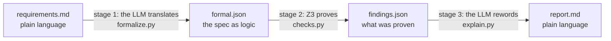
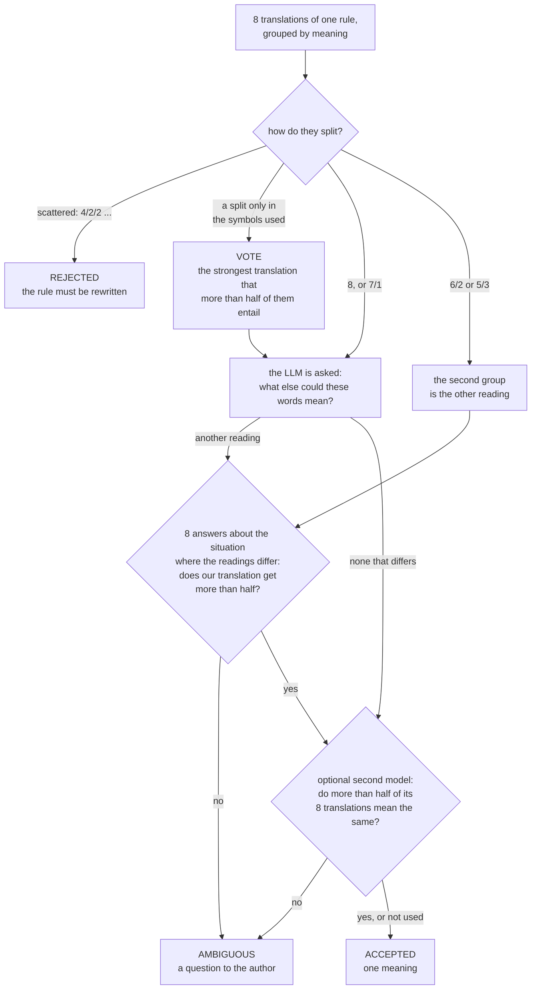

# speccheck: a guided tour


| Part | What it covers |
|---|---|
| [0](#0-the-whole-project-on-one-screen) | the whole project on one screen |
| [1](#1-background) | how to read a formula, and what the Z3 solver does |
| [2](#2-the-basic-pipeline-on-one-small-spec) | the basic pipeline, followed on a spec of five rules |
| [3](#3-four-ways-the-translation-goes-wrong-and-the-four-repairs) | the four things that go wrong, and the repair for each |
| [4](#4-how-sure-is-a-finding) | how much to trust a finding |
| [5](#5-checking-a-change-against-the-specs-that-exist) | the same check for a change to specs that already exist (OpenSpec) |
| [6](#6-where-we-are) | how we measure, the results, the limits, what comes next |
| [7](#7-what-to-open-next) | what to run and read, in order, and a small glossary |

---

## 0. The whole project on one screen

Requirements are written in plain language, and plain language lets mistakes
through. Three kinds matter here:

- two requirements contradict each other: one says "place the order on
  backorder", another says "never backorder";
- a case is left out: nothing says what should happen when no order was submitted;
- a sentence can be read in two ways: does "reaches 5" mean exactly 5, or 5 or more?

Usually nobody notices until the code is written. The
[Kiro blog](https://kiro.dev/blog/deep-spec-analysis/) describes a way to catch
these mistakes earlier: let a language model translate the requirements into
logic, and let a solver *prove* what is wrong with that logic. This project
rebuilds that idea as a small prototype, to understand how it works and to
measure how well it does.

The tool is called `speccheck`, and it works in three stages:



Three parties are at work, and it helps to keep them apart:

| Who | What it does | Can it be wrong?                        |
|---|---|-----------------------------------------|
| the LLM | translates the text into logic (stage 1) and puts the results into words (stage 3) | yes                                     |
| Z3, the solver | proves every conflict, gap and scenario (stage 2) | no, not about the formulas it was given |
| our Python code | decides which questions Z3 is asked, and does the counting and voting | code with tests, not formally proven :) |

That table holds the main idea of the whole project. Z3 never makes a mistake
about the formulas it is given, but those formulas were written by a language
model, and a language model does make mistakes. So most of the work, and most
of the code, deals with one question: can we trust the translation, and when
we cannot, do we say so clearly?

The same tool also checks a *change* against specs that already exist, which
is how OpenSpec projects work. That is part 5.

To give an idea of the size: about 3,700 lines of Python now, half of them comments
and prompts, one local model (Qwen3.8, 27B), and results measured on 297 versions
of small specs and on 138 changes. The results are in part 6.

---

## 1. Background

### 1.1 How to read a formula

The formulas use a notation called SMT-LIB. It looks odd at first, because the
operator comes first, inside the parentheses:

| You see | Read it as |
|---|---|
| `(and a b)` | a and b |
| `(not a)` | not a |
| `(=> a b)` | if a then b |
| `(= x 5)` , `(>= x 5)` | x is 5 , x is 5 or more |
| `(xor a b)` | exactly one of a and b is true |

A longer formula is read from the inside out:

```
(=> (and order_submitted (not inventory_available)) order_on_backorder)
     └──────────── if this ─────────────────────┘   └── then this ──┘

"if an order is submitted and inventory is not available, the order is on backorder"
```

There is one trap, and it matters later. In logic, `(=> a b)` is true whenever
`a` is false. Think of "if it rains, I take an umbrella": on a sunny day you
have not broken that promise, whatever you carry. We will need this in 2.3.

### 1.2 What Z3 does

Z3 is a solver. You hand it some formulas, and it answers exactly one kind of
question:

> Is there a situation in which all these formulas hold?

The answer is either "yes" (the technical word is *satisfiable*), together
with one such situation, or "no" (*unsatisfiable*). That "no" is a proof: no
such situation exists.

A *situation* is simply a value for every symbol, a snapshot of the system:
`order_submitted = true, inventory_available = false`, and so on.

That is all Z3 does. Whenever the documents say that something is counted,
voted on, grouped or repeated, it is our Python code doing it, and each time
it asks Z3 this one question.

How do you prove anything with a tool that only looks for situations? You ask
it for a counterexample. If Z3 proves that no counterexample exists, the thing
you wanted to know is true. The project uses this in three forms:

| We want to know | We ask Z3 for a situation where... | If Z3 proves there is none |
|---|---|---|
| do the formulas T1 and T2 mean the same? | one holds and the other does not: `(xor T1 T2)` | they mean the same |
| does fact F follow from the facts G? | G holds and F does not: `(and G (not F))` | F follows from G |
| can the rules be obeyed in situation S? | S holds and every rule holds | they cannot: a **conflict** |

When Z3 answers "yes" instead, the situation it returns is useful too. It
becomes the concrete example shown to the person. The other documents call it
the *witness*, and the JSON files store it in a field named `when`.

---

## 2. The basic pipeline, on one small spec

We now follow one small spec through the three stages. It is the
order-processing example from the Kiro blog, in `specs/order/requirements.md`:

```
R1: WHEN an order is submitted AND inventory is available, THE Order System SHALL fulfill the order.
R2: WHEN an order is submitted AND inventory is unavailable, THE Order System SHALL place the order on backorder.
R3: THE Order System SHALL NOT place any order on backorder.
R4: WHEN an order is canceled, THE Order System SHALL refund all associated payments.
R5: WHILE an order is in a canceled-and-refunded state, THE Order System SHALL NOT fulfill the order.
```

### 2.1 Stage 1: the LLM translates

The model first decides which facts the text is about, and gives each one a
name. These named facts are the *symbols*:

```
order_submitted        yes/no    "An order has been submitted by a customer."
inventory_available    yes/no    "The inventory for the ordered items is available."
order_on_backorder     yes/no    "The order system has placed the order on backorder."
...                    (7 in all)
```

Then it writes each requirement as a *rule* with two halves: when the rule
applies (the *antecedent*) and what must be true then (the *consequent*).

| Rule | when (antecedent) | then (consequent) |
|---|---|---|
| R1 | `(and order_submitted inventory_available)` | `order_fulfilled` |
| R2 | `(and order_submitted (not inventory_available))` | `order_on_backorder` |
| R3 | `true` (always) | `(not order_on_backorder)` |
| R4 | `order_canceled` | `payments_refunded` |
| R5 | `order_canceled_and_refunded` | `(not order_fulfilled)` |

Each row means "if antecedent, then consequent". The result is saved as
`formal.json`, and that file is all the next stage ever sees.

### 2.2 Stage 2: Z3 looks for three kinds of situation

No language model is involved here. Our code asks Z3 for three kinds of
situation, and each kind becomes a finding:

| Finding | What it says | In the order spec |
|---|---|---|
| **conflict** | in this situation the rules cannot all be obeyed | an order is submitted and there is no stock: R2 says backorder it, R3 says never |
| **gap** | in this situation no rule applies | no order submitted, none canceled: what should the system do? |
| **scenario** | the rules allow this. Was it meant? | an order is fulfilled although none was submitted |

There is a fourth kind of finding, the *ambiguity*. It works differently, and
section 3.1 explains it.

### 2.3 How a conflict is found

The obvious question for Z3 is "is there a situation in which all five rules
hold?". It does not work. Z3 answers yes, and shows the situation in which no
order is submitted and none is canceled. The four rules that have a condition
demand nothing there (the umbrella on a sunny day, from 1.1), and R3 is obeyed
because nothing is on backorder. All five rules hold, and we have learned
nothing about R2 and R3.

So we do not let Z3 pick the situation. We fix it ourselves, with the "when"
part of a rule, and ask two questions:

| | What Z3 is given | Z3 answers | What that tells us |
|---|---|---|---|
| question 1 | only the "when" part of R2: `(and order_submitted (not inventory_available))` | yes | this situation can happen |
| question 2 | the same "when" part, and all five rules | no | in this situation the rules cannot all be obeyed: a **conflict** |

Adding the "when" part of a rule to the question is called *forcing the rule
to apply*. The answer to question 2 is "no" because, once an order is
submitted and there is no stock, R2 demands the backorder and R3 forbids it.

Our code asks these two questions for every rule on its own, for every pair of
rules and for every group of three. For a pair, both "when" parts are added.
Question 1 then drops the pairs that can never apply together, such as R1 and
R2: stock cannot be available and unavailable at once. The report names only
the rules that the clash needs, here R2 and R3, and not all five.

### 2.4 How a gap and a scenario are found

**A gap** is a situation in which something happens and no rule says what to
do. Our code takes each *event*, which is something that happens at one
moment, such as "an order is submitted". For each event it asks Z3: is there a
situation in which this event happens and the "when" part of every rule is
false?

| Question to Z3 | Answer | Why |
|---|---|---|
| an order is submitted, and no rule applies? | no | with stock R1 applies, without stock R2 applies |
| an order is canceled, and no rule applies? | no | R4 applies |
| no event happens, and no rule applies? | yes | nothing happened, so no rule was asked for anything |

R3 is left out of this check. It has no "when" part: it forbids something in
every situation and reacts to nothing, so it never says what to do.

The order spec has only the last gap. The report marks it "no event happens",
because it is rarely a problem: when nothing happens, a system normally just
waits. A spec with R1 and without R2 would have a real gap: "an order is
submitted, inventory is not available, and no rule applies".

**A scenario** is a situation that the rules allow, although the author may
not have meant to allow it. For each rule we ask Z3: is there a situation in
which all rules hold, this rule does *not* apply, and what it demands happens
anyway? For R1 the answer is yes:

```
order_fulfilled = true, order_submitted = false     an order is fulfilled although none was submitted
```

The rules allow this because R1 says "when an order is submitted, fulfill
it", and not "fulfill an order only when one was submitted". The tool cannot
know whether that matters, so it shows the situation and the author decides.
The reverse also exists: a situation that the rules make impossible, which the
report shows as "ruled out".

Gaps and scenarios are easy to confuse. In a gap the spec says nothing. In a
scenario the spec does decide, and the question is whether that was intended.

### 2.5 Stage 3: the LLM rewords

The findings are facts about formulas, which nobody wants to read. So the model
is asked to say each one in the words of the requirements, and to offer two
choices: keep the text as it is, or make one specific change.

> **1. Conflict: Backorder Requirement Conflict**
>
> [...] In the situation where an order is submitted but inventory is
> unavailable, R2 requires the system to place the order on backorder, while
> R3 explicitly forbids the system from placing any order on backorder.
>
> - **A) Keep as-is:** [...]
> - **B) Change:** Remove R3 entirely, or modify R3 [...]
>
> *Proven:* Requirements R2, R3 cannot all be obeyed in this situation:
> - FALSE: inventory_available
> - TRUE: order_submitted

Two things keep this stage honest. The model is told that the finding is
proven and that it may only reword it. And under each explanation the report
prints the lines marked *Proven*, which are the exact facts from Z3, so you
can compare the wording with what was actually shown.

### 2.6 Try it now

You do not need a GPU for this. The repository contains a saved `formal.json`
for the order spec, so the solver stage can run without the model. The report
then holds the proven facts, without the wording. From the project folder,
inside its `.venv`:

```
python -m speccheck specs/order/requirements.md --formal specs/order/formal.json --out out
python -m pytest tests
```

It is also worth spending five minutes with Z3 directly. Start `python` in the
project folder and paste this:

```python
import json
from speccheck.logic import Vocabulary

formal = json.load(open("specs/order/formal.json", encoding="utf-8"))
vocab = Vocabulary(formal["symbols"])                    # symbols -> Z3 variables
R = {r["id"]: vocab.rule(r) for r in formal["rules"]}    # rules   -> Z3 formulas
all_rules = [r.formula for r in R.values()]

vocab.model(all_rules)                    # a situation: all rules hold when nothing happens
situation = [R["R2"].antecedent]          # force R2 to apply
vocab.model(situation)                    # a situation: it can happen
vocab.impossible(situation + all_rules)   # True: no way to obey all rules there
```

`vocab.model` means "give me a situation", and `vocab.impossible` means "prove
there is none". The whole solver stage is built from these two calls.

---

## 3. Four ways the translation goes wrong, and the four repairs

What you have seen so far is the easy part. If the model always translated
correctly, the project would end here. It does not, and when the translation
is wrong, Z3 goes on to prove something about the wrong formulas, with
complete confidence.

Four things go wrong in practice. Each has its own repair, and each repair
leaves a visible trace in the report, so the reader can tell how far to trust
a finding:

| What goes wrong | Example | The repair | What the report shows |
|---|---|---|---|
| a sentence has two meanings, and the model silently picks one | "reaches 5": exactly 5, or 5 or more? | the ambiguity check (3.1) | an **Ambiguity**: a question to the author |
| two rules say opposite things in different words, and Z3 sees two unrelated symbols | "grant access" and "deny access" | assumed facts: voted, links, and questions about two outcomes (3.2) | "Conflict (**if the assumed facts hold**)" |
| the logic is one snapshot with yes/no symbols, so findings appear that are not real | two events "at the same moment" | the doubtful mark (3.3) | "Conflict (**doubtful**: ...)" |
| another run picks other symbols, and gives other findings | a conflict found in one run and missed in the next | several symbol sets (3.4) | "**found with 3 of 3** symbol sets" |

The next four sections take them one by one.

### 3.1 Does a rule have only one meaning?

Take this rule from the login spec in `specs/auth_openspec`: "WHEN the number
of failed attempts on an account reaches 5 THEN the system locks the account".
Most people read it without hesitating, and yet two developers could build two
different systems from it:

```
reading A   exactly 5      (=> (= failed_attempts 5)  account_locked)
reading B   5 or more      (=> (>= failed_attempts 5) account_locked)
```

The two readings disagree in one situation only: 6 failed attempts, and the
account *not* locked. Reading A is obeyed there, because it says nothing about
6 attempts. Reading B is broken, because it demands the lock. Both parts of
the situation are needed: at 5 attempts the two readings agree, and a locked
account obeys both.

Left alone, the model picks one reading and says nothing. The tool has three
ways to notice that there are two.

1. **Sample.** The model translates the rule eight times, independently, and
   our code puts the translations that mean the same into one group. Two
   translations mean the same when Z3 proves that no situation tells them
   apart (the first row of the table in 1.2). If two or three of the eight
   form a second group, that group is a second reading. If the eight scatter
   widely (4/2/2, for example), the rule is rejected and has to be rewritten,
   unless they differ only in the symbols they use (the vote, below).
   The weakness of sampling is that one model tends to make the same choice
   every time. Here the eight split seven to one, which counts as agreement.

2. **Ask about a concrete case.** If sampling gave no second reading, the
   model is asked what else the words could mean. Here it proposes reading B.
   Z3 then finds the situation in which the two readings disagree, the one
   above, and the model is asked about it eight times:

   ```
   Requirement   WHEN the number of failed attempts on an account reaches 5
                 THEN the system locks the account
   Situation     the number of failed attempts is 6; the account is not locked
   Reading A     exactly 5: the requirement is obeyed in this situation
   Reading B     5 or more: the requirement is broken in this situation
   Question      do the words of the requirement support A, B, or either?
   ```

   Our translation stands only if it gets more than half of the answers. Here
   "exactly 5" got one answer and "5 or more" got six, so the rule is reported
   as ambiguous. This step is in `probe.py`.

3. **A second model (optional).** A model from another family translates the
   same rule eight times, and our code counts, with Z3, how many of these
   translations mean the same as ours. If half or fewer do, the rule is
   reported as ambiguous. The idea: two different readers translate a clear
   sentence the same way, so when they differ, the sentence is probably the
   reason.

**When the translations differ only in their symbols, they vote.** Not every
split is two readings. For a real rule the list of symbols often has a
general and a specific symbol for the same outcome, and the eight
translations pick different ones (one of the eight was not a formula here):

```
"WHEN move succeeds THEN display success message with archived name and list of updated specs"
3 x  move_succeeds => success_message_displayed
2 x  move_succeeds => (and success_message_displayed spec_summary_displayed)
1 x  move_succeeds => (and success_message_displayed specs_updated)
1 x  move_succeeds => (and success_message_displayed updated_specs_tracked spec_summary_displayed)
```

These are four groups, and the rule would be rejected. Yet all seven agree
on the success message.

1. Our code checks that the split is about symbols: no two translations that
   use the same symbols differ in meaning. "Exactly 5" and "5 or more" use
   the same symbols, so that rule never gets here. It stays a question.
2. For each translation, our code asks Z3 which of the others entail it: is
   there a situation in which the other one holds and this one does not? The
   first line is entailed by all seven.
3. The strongest translation that more than half of them entail becomes the
   translation of the rule, here the first line. The rule is accepted, and
   `formal.json` records `"voted": "7/7"`. If no translation has such a
   majority, the rule stays as it was.

A voted rule can say less than its words: the list of updated specs is not
in the formula. That is the price of keeping the rule in the checks.

**When a rule has no symbol for what it demands, it is read again.** The
model lists the symbols for the whole document in one answer, and for a
long document it leaves some out. A rule then cannot be written:

```
"WHEN file write fails THEN let the error bubble up naturally with file path"
file_write_failed => true
```

The model understood the rule; the list has no symbol for the error. A
translation like this one demands nothing.

1. Our code takes the rules that are not accepted and have a translation
   that demands nothing.
2. The model reads those rules again, alone, in one call. It is shown the
   symbols so far and told that something these rules demand has no symbol.
   Here it adds `error_bubbles_up_with_path`.
3. The rules are translated eight more times with the longer list. Here all
   eight say `file_write_failed => error_bubbles_up_with_path`.
4. Our code keeps a new translation only if it is accepted now, and a new
   symbol only if such a translation uses it. So a second read that helps
   no rule changes nothing.

The three ways together, as a diagram:



The report does not give a verdict on an ambiguity. It asks a question (this
is real output):

> **1. Ambiguity: Ambiguity in lock threshold**
>
> Requirement R3 is ambiguous because it is unclear whether the account
> should be locked when the number of failed attempts is exactly 5 or when it
> is 5 or more. [...] Which did you mean?

Until the author answers, the checks go on with reading A, so another finding
may exist only because of that choice. The solver therefore tries each
ambiguous rule once more with its other reading. In the login spec that
changes nothing. In a spec for topping up a phone it does
(`experiments/examples/topup_reading`). Its rule R4 is "WHEN a customer enters
a wrong PIN for the third time THEN the system locks the account for 24
hours". It was read as "exactly the third time", so nothing says what to do at
the fourth wrong PIN, and the report has a gap there. With the other reading,
"the third time or later", R4 applies and the gap is gone. The title of the
gap says so:

> **4. Gap (depends on the reading of R4): Unclear PIN lock trigger**
>
> The requirements do not specify what the system must do when a customer
> enters a wrong PIN for the fourth time. This gap exists only if R4 is read
> to mean the account locks strictly when the count reaches three; [...]

### 3.2 Telling the solver what the words mean

Here are two more rules from the same login spec:

```
R1  "WHEN a user submits a correct password THEN the system grants access"
    (=> (and password_submitted password_correct) access_granted)

R4  "WHEN a user submits a password for a locked account THEN the system denies access"
    (=> (and password_submitted account_locked) access_denied)
```

Anyone can see the problem: what happens when someone enters the correct
password for a locked account? R1 says grant access, R4 says deny it. Z3 does
not see it. To Z3, `access_granted` and `access_denied` are two unrelated
yes/no values, and when we ask about that situation it calmly answers:

```
access_granted = true, access_denied = true        both rules obeyed, no conflict
```

What is missing is a piece of common sense that nobody wrote down: access
cannot be granted and denied at once. The repair is to let the model supply
such facts, with some care.

#### Voted facts

A *voted fact* is a piece of common sense that the model proposes and that
most of its answers agree on. It is made in four steps:

1. **The model is asked eight times** to list the statements that are always
   true because of what the symbols mean. It sees only the symbols and their
   descriptions, not the requirements, so it cannot pass off a requirement as
   a fact.
2. **Each of the eight answers is a list of facts**, and every fact is a
   sentence with its formula. For example: "The system cannot simultaneously
   grant and deny access", `(not (and access_granted access_denied))`. An
   empty list is a valid answer too.
3. **The answers vote.** Every fact in every answer is a candidate. An answer
   votes for a candidate when Z3 proves that the candidate follows from the
   facts in that answer (the second row of the table in 1.2). So answers that
   say the same thing in different words vote for the same candidate.
4. **Our code keeps a candidate that has more than half of the eight votes.**
   It is then called an *assumed fact*, and it is saved in `formal.json` with
   its votes.

This is the vote in one run of the login spec:

| Candidate | Votes | Kept? |
|---|---|---|
| access cannot be granted and denied at once | 6 of 8 | yes |
| the number of failed attempts is not negative | 6 of 8 | yes |
| a locked account grants no access | 1 of 8 | no. It says what the system should do, not what the words mean |

In the run saved in `specs/auth_openspec/`, the first two have 7 of 8 votes.

#### How the conflict search uses a fact

The conflict search of 2.3 forces pairs of rules to apply, and one pair is R1
and R4. Their two "when" parts together give the situation from above: a user
submits the correct password for a locked account. In it, as in every
situation it builds, the search asks its question twice:

| | What Z3 is given | Z3 answers | Result |
|---|---|---|---|
| search 1 | the situation and the rules | yes, with `access_granted = true` and `access_denied = true` | no conflict from the rules alone |
| search 2 | the situation, the rules and the assumed facts | no: access cannot be granted and denied at once | a **conflict**. The report says "if the assumed facts hold" and quotes the fact |

Search 1 never sees the facts, so a fact can add a conflict and can never hide
one. We learned this the hard way. Early in the project, seven of eight
answers agreed that "an order cannot be both fulfilled and canceled". That is
a business rule, not a fact about what the words mean, and at the time it made
a real conflict in the order spec disappear.

#### Links

Voted facts do not solve every case. The second example of the Kiro blog
(`specs/delete_property`) has these two requirements:

```
D2   "WHEN a Property Owner confirms deletion, THE Platform SHALL remove the
      Property record from the Platform"
     (=> deletion_confirmed property_record_removed)

D4   "THE Platform SHALL implement soft deletion to retain Property records in
      the database for audit purposes while hiding them from the user interface"
     (=> property_deleted (and property_record_retained_in_db property_hidden_from_ui))
```

D2 removes the record and D4 keeps it. Z3 does not see the clash, because
`property_record_removed` and `property_record_retained_in_db` are two
unrelated symbols: a record can be removed and retained at once. No fact was
voted to connect them, because the symbols alone do not settle it: a record
"removed from the Platform" could still be in the database.

A *link* takes the connection from the text of D2 instead. It is made in four
steps:

1. **Our code picks D2**, because what D2 demands is written with a symbol
   that no other rule uses, `property_record_removed`.
2. **The model translates D2 again, eight times, without that symbol.** It may
   use only the symbols of D2's own "when" part and the symbols with which
   the other rules say what they demand, such as
   `property_record_retained_in_db` from D4. It may also answer that these
   symbols cannot express D2.
3. **Our code groups the eight answers by meaning**, as in 3.1. Here all eight
   said the same: `(=> deletion_confirmed (not property_record_retained_in_db))`,
   "when the owner confirms the deletion, the record is not retained in the
   database". A meaning with more than half of the answers becomes the link.
4. **The link is tested before it is used**, because "remove" could still
   mean "hide". The model is shown the text of D2 and the one situation that
   would prove the link wrong: the owner has confirmed the deletion, and the
   record is still in the database. It is asked eight times whether this
   could be true in a system that does everything D2 demands. The link is
   kept only if more than half of the answers say "impossible". For D2 all
   eight did.

A link is used like a voted fact, only in search 2. With it, Z3 sees that D2
means "not retained" where D4 says "retained", and the conflict between D2 and
D4 is found. The report says "if the assumed facts hold" and quotes the link,
so the reader can judge whether "remove" really means that.

#### Questions about two outcomes

Voted facts come from an open question ("which facts connect these
symbols?"), and the answers often do not mention the pair that matters. Take
these two rules of a canteen spec (`experiments/sets/eval7/canteen_overlap`):

```
C1   "WHEN a student taps the card at the till AND the card balance covers the meal,
      THE Canteen System SHALL take the price from the balance."
     (=> (and card_tapped (>= card_balance meal_price)) payment_taken)

C6   "WHILE the canteen is closed for holidays, THE Canteen System SHALL refuse all payments."
     (=> canteen_closed_for_holidays payment_refused)
```

A student who taps the card during the holidays falls under both. Z3 sees no
conflict, because `payment_taken` and `payment_refused` are two symbols and no
voted fact said that they exclude each other. That was a miss in 3 of 3 runs.
So the pair is asked about directly, in four steps:

1. **Our code and Z3 pick the pairs of rules worth asking about.** Both rules
   must be able to apply in the same situation, they must not react to two
   different events (that conflict would be doubtful anyway, see 3.3), and
   what they demand must share no symbol. C1 and C6 qualify. This spec has
   four such pairs.
2. **The model is asked eight times about the two outcomes alone.** It does
   not see the requirements, only this:

   ```
   Statement A:   TRUE: payment_taken (The system has deducted the meal price from the card balance)
   Statement B:   TRUE: payment_refused (The system has declined the payment request)
   Question:      can A and B both hold in the same snapshot?   possible / impossible / unclear
   ```

3. **Our code counts.** If more than half of the answers say "impossible",
   that becomes an assumed fact. Here all eight did:
   `(not (and payment_taken payment_refused))`, "A payment cannot be
   successfully taken and refused at the same time."
4. **Z3 proves the conflict** between C1 and C6 in search 2, like any conflict
   that needs a fact, and the report quotes the fact.

Of the other three pairs, two were called possible ("send a reminder" and
"refuse all payments" can both happen). The third was called impossible:
"refuse all payments" against "add the top-up to the balance". Nobody had
planted that conflict, and it is a fair one. This is the price of the step: it
finds conflicts said in other words, and it also reports more conflicts than
we planted (6.2).

### 3.3 Marking the findings that are probably not real

The formulas describe one snapshot of the system, with no "before" and no
"after". This produces findings that are correct as logic and meaningless in
practice. They come in two shapes.

The first shape is two events in the same instant. Take a newsletter spec:

```
rule 1      "WHEN a visitor submits the signup form THEN the system sends no email ..."
rule 2      "WHEN a subscriber changes the email address THEN the system sends a confirmation email"

situation   visitor_signed_up = true, address_changed = true
            "no email" against "an email": a conflict
```

Z3 is free to let both events happen in one snapshot, but nobody writes
requirements for two unrelated events in the same instant. So when the model
reads the spec, it also names the event each rule reacts to, the rule's
*trigger*. A conflict between rules with different triggers is marked as
doubtful.

The second shape is a situation that cannot happen. Take a booking spec:

```
"cancels at least 24 hours before": no fee        "less than 24 hours before": a late fee

situation   at_least_24h = true, less_than_24h = true     no fee and a late fee: a conflict
fact        (not (and at_least_24h less_than_24h))        this situation cannot happen
```

The two conditions became two separate yes/no symbols, so Z3 can make both
true. A conflict whose situation the assumed facts rule out is marked as
doubtful too.

A gap can have this second shape as well. In a laundry spec, "the slot is
free" and "the slot is taken" became two symbols, and Z3 can make both false:

```
situation   resident_books_slot = true, slot_is_free = false, slot_is_taken = false     no rule applies: a gap
fact        (or slot_is_free slot_is_taken)                                             this situation cannot happen
```

Such a gap is marked as doubtful when the model has proposed that fact. It
rarely does, so most gaps of this kind stay unmarked (6.2).

In every case the finding stays in the report, with the word "doubtful" and
the reason. It is marked and not deleted because the mark is itself a guess:
in the evaluation it also landed, a few times, on real conflicts that we had
planted.

### 3.4 Do the findings depend on the symbols?

Everything starts from the symbols that the model picks in its very first
step, and it does not always pick the same ones. A conflict found in one run
can be missed in the next, simply because the second run described the facts
differently.

The answer is to translate several times and count. With `--symbol-sets 3` the
spec is formalized three times, each time with its own symbols, and every
finding says how many of the three found it:

> **3. Conflict (found with 3 of 3 symbol sets): Conflict between removal and retention**

In the evaluation, the findings that most symbol sets agreed on were never wrong.

### 3.5 Recap

Seven steps, all in `formalize.py`. In a pipeline diagram above they
look arbitrary. Now each one has a reason:

| Step | What happens | Why it is there |
|---|---|---|
| 1 read | one LLM call lists the rules, picks the symbols, and names each rule's trigger | everything starts here; the triggers serve 3.3 |
| 2 sample | each rule is translated 8 times | 3.1 |
| 3 cluster | the 8 translations are grouped by meaning, with Z3 | 3.1 |
| 4 facts | 8 answers propose facts, and they vote, with Z3 | 3.2 |
| 5 links | a rule with a symbol of its own is said again in the other rules' terms | 3.2 |
| 6 probe | questions about concrete situations, and about pairs of outcomes (`probe.py`) | 3.1 and 3.2 |
| 7 second | optional: a second model translates every rule | 3.1 |

---

## 4. How sure is a finding?

Each repair leaves its mark in the title of a finding, so the title tells you
how much weight the finding carries:

| The title says | What it means | How far to trust it |
|---|---|---|
| "Conflict: ..." | proven from the rules alone | a lot. It is wrong only if the translation is wrong |
| "Conflict (if the assumed facts hold): ..." | proven only with a guessed fact, which the report quotes | read the quoted fact and judge it yourself |
| "Conflict (doubtful: ...)" | proven, but it has the shape of the artefacts in 3.3 | little. In the evaluation nearly all of these were false alarms |
| "... (depends on the reading of R4)" | proven with the first reading of R4, which is ambiguous; gone with its other reading | answer the question about R4 first |
| "... (found with k of K symbol sets)" | k of the K formalizations found it | the higher k, the better |
| "Ambiguity: ..." | not a proof, a question to the author | a fair question, though some are asked about clear rules |
| "Not checked: ..." | the requirement could not be written in logic: no symbol stands for what it demands. It took no part in the checks | nothing was found about it because nothing was looked for. Stating its outcome as one plain fact helps |
| "Gap: ..." | proven: an event happens and no rule applies | certain. Ask yourself whether that case was left out on purpose |
| "Gap (doubtful: ...)" | proven, but the assumed facts say its situation cannot happen (3.3) | little: usually two symbols for one yes/no question |
| "Gap (opened by removing X1): ..." | proven, when a change is checked: a rule that the change removes used to cover this situation (part 5) | certain. The change left this case open |
| "Gap (no event happens): ..." | proven: nothing happens, and no rule applies (2.4) | certain, but rarely something to fix. Almost every spec has this gap, so it is shown once, after the other gaps |
| "Scenario, allowed: ..." or "Scenario, ruled out: ..." | proven: the rules allow this situation, or make it impossible (2.4) | the proof is certain. Which scenarios are shown is the model's choice, and whether one is a problem is for you, the author, to decide |

If you keep one thing from this part: a finding is a proof about
`formal.json`, not a proof about what the author meant. When a finding looks
wrong, open `formal.json` and read how that rule was translated. Most of the
time the explanation is there.

---

## 5. Checking a change against the specs that exist

So far the tool checked one document. Real projects rarely start from an
empty page: the specs already say what the system does, and new work arrives
as a *change*. OpenSpec keeps a project that way:

```
openspec/specs/auth/spec.md                               what the system does today
openspec/changes/admin-never-locked/specs/auth/spec.md    the change: only what is added, modified or removed
```

The example is in `specs/auth_change`. The spec that exists has four
scenarios. One of them:

```
### Requirement: Account Lockout
#### Scenario: Lockout threshold
- **WHEN** the number of failed attempts on an account reaches 5
- **THEN** the system locks the account
```

The change adds one requirement:

```
## ADDED Requirements
### Requirement: Administrator Access
#### Scenario: Administrators are never locked out
- **WHEN** the account belongs to an administrator
- **THEN** the system does not lock the account
```

Read alone, the change is fine, and so is the spec. The conflict exists only
between the two: an administrator's account with 5 failed attempts. This
command finds it:

```
python -m speccheck --change specs/auth_change/openspec/changes/admin-never-locked --base-url ...
```

It works in four steps:

1. **Our code merges.** It applies the change to the specs, the way OpenSpec
   itself does when a change is archived: requirements are matched by their
   name, and added, replaced, removed or renamed. The result is one document,
   `merged.md`. In it our code writes a label into the header of every
   scenario, from `#### Scenario R1: Valid credentials` to
   `#### Scenario R5: Administrators are never locked out`, and it remembers
   that R5 is the one the change added.
2. **The LLM and Z3 do what they always do.** The merged document goes
   through the three stages of part 2, with the repairs of part 3. Nothing in
   the prompts or in the solver stage knows about changes. The model uses the
   labels as the ids of the rules, so the rules come back as R1 to R5.
3. **Our code selects.** Z3 proved four things about the merged document, and
   only one of them involves a rule of the change:

   | Finding | Rules | About the change? |
   |---|---|---|
   | conflict: 5 failed attempts on an administrator's account | R3, R5 | yes: R5 was added |
   | conflict: a correct password for a locked account (3.2) | R1, R4 | no: both rules were there before |
   | ambiguity: "reaches 5" (3.1) | R3 | no |
   | gap: no event happens | none | no |

   A conflict, an ambiguity or a scenario is about the change when one of its
   rules was added or modified. A gap is about the change when such a rule
   reacts to the event that happens in it, or when a rule that the change
   removes used to cover it (see below).
4. **The LLM words what was kept.** The report shows the one conflict, says
   that 3 other findings are in `findings.json`, and ends with a table that
   tells where each rule comes from:

   > **1. Conflict: Administrator Account Lock Conflict**
   >
   > Requirement R3 states that the system must lock an account when the
   > number of failed attempts reaches 5. However, Requirement R5 states that
   > the system must not lock an account if it belongs to an administrator. [...]
   >
   > | Rule | Spec | Requirement | Scenario | |
   > |---|---|---|---|---|
   > | R3 | auth | Account Lockout | Lockout threshold | |
   > | R5 | auth | Administrator Access | Administrators are never locked out | **added** |

**When a change removes something.** A change can also take a rule away, and
then a case may be left open. In a spec for hospital visitors
(`experiments/examples/visitors_removed`), two scenarios cover a check-in: the
visitor is on the patient's list, or is not. A change rewrites the requirement
and drops the second scenario. To ask Z3 about the case that this scenario
covered, the case must be written with the symbols of the rules that stay,
and only the model writes formulas. Three more steps deal with that:

1. **Our code keeps the dropped scenario in the merged document**, under a
   label of its own, X1. So the model formalizes it together with the rest,
   with the same symbols: `(and visitor_checks_in (not visitor_on_list))`.
2. **Our code takes X1 out of the formal model before the checks** and keeps
   it apart. A removed rule can neither cause a finding nor hide one.
3. **Z3 is asked about the situation X1 was written for**: a visitor checks
   in and is not on the list. Does any remaining rule apply there? None does.
   So this is a gap, and the report says who opened it:

   > **1. Gap (opened by removing X1): Missing rule for unauthorized check-in**
   >
   > The requirements do not specify what the system must do when a visitor
   > who is not on the patient's visitor list attempts to check in. This gap
   > exists because the previous rule that handled this specific scenario was
   > removed.

The question of step 3 is the gap question of 2.4, asked about the situation
of X1. Z3 gets a list of formulas and says whether all of them can be true at
once:

| In words | What Z3 is given | Where our code takes it from |
|---|---|---|
| a visitor checks in, and nothing else happens | `visitor_checks_in` is true; `visiting_time_ends` and `visitor_leaves_without_badge` are false | the model has three events: the one X1 reacts to is set to true, the other two to false |
| the visitor is not on the list | `(and visitor_checks_in (not visitor_on_list))` | the "when" part of X1, as the model translated it in step 1 |
| no remaining rule applies | `(not (and visitor_checks_in visitor_on_list))`, and the same for R2, R3 and R4 | the "when" part of every rule that stays, negated |

Z3 answers yes and shows one such situation. Our code saves it in
`findings.json`, with the rule whose removal opened it:

```
"type": "gap", "event": "visitor_checks_in", "opened_by": ["X1"],
"when": {"visitor_checks_in": true, "visitor_on_list": false, ...}
```

Had Z3 answered no, some remaining rule would apply whenever X1 did, and the
removal would have opened nothing.

If a change removes the only rule for an event, the question is not asked and
nothing is reported. Nobody reacts to that event any more, and that was the
point of the change.

**Not starting from zero for every change.** As described so far, the merged
document is formalized as a whole for every change. That is what gives the
old and the new rules the same symbols, and without shared symbols Z3 sees no
conflict (3.2). It also means that a change of one scenario costs as much as
the whole project. With `--incremental` it goes another way:

1. **The specs that exist are formalized once.** Their formal model is saved
   next to them, in `openspec/.speccheck/base.json`, and made again only when
   the specs change.
2. **Our code writes down what is new in the change**: the added and the
   reworded scenarios, labelled N1, N2, ... For the login example that is one
   scenario, N1, "administrators are never locked out".
3. **The model formalizes only that**, and it is shown the symbols of the
   saved model first, with two more instructions. Use a listed symbol
   wherever it fits, and add a new one only for a fact that has none. And
   read each rule by its own words: a listed event is the trigger of a rule
   only if the rule names it.
4. **Our code puts the two together**: the saved rules, without the removed
   and the reworded ones, plus the new rules. The checks, the selection and
   the wording are the same as before.

For the login example, this is everything the model is sent in step 3
(`experiments/examples/auth_incremental`). The text of the four scenarios
that exist is not in it:

```
Symbols of the system so far:
- password_submitted: Bool, event - A user has submitted a password for authentication
- password_correct: Bool - The submitted password matches the stored password for the account
- access_granted: Bool - The system has granted access to the user
- access_denied: Bool - The system has denied access to the user
- failed_attempts_count: Int - The number of consecutive failed login attempts for the account
- account_locked: Bool - The account is currently in a locked state

Document:
# auth Specification
### Requirement: Administrator Access
Administrators MUST always be able to reach the system.
#### Scenario N1: Administrators are never locked out
- **WHEN** the account belongs to an administrator
- **THEN** the system does not lock the account
```

The six symbols are those of the saved model: the model chose these names
itself when the specs were formalized. The document is `new.md`, which our
code wrote in step 2. The model answers with the rule, and with the symbols it
adds, here one:

```
rules:    N1  "WHEN the account belongs to an administrator THEN the system does not lock the account"
symbols:  is_admin: Bool - The account belongs to an administrator
```

Then it translates N1 eight times, as every rule (3.1). All eight said
`(=> is_admin (not account_locked))`: the new `is_admin`, and the
`account_locked` that the lockout rule R3 already uses. Because the two rules
share that symbol, the two questions of 2.3 find the conflict, for the pair R3
and N1:

| | What Z3 is given | Where our code takes it from | Z3 answers |
|---|---|---|---|
| question 1 | `(= failed_attempts_count 5)` and `is_admin` | the "when" part of R3, from the saved model, and that of N1, just translated | yes: 5 failed attempts on an administrator's account |
| question 2 | the same, and all five rules | the four saved rules and N1 | no: `account_locked` would have to be true and false |

```
"type": "conflict", "rules": ["R3", "N1"], "about_change": true,
"when": {"failed_attempts_count": 5, "is_admin": true}
```

N1 is a rule of the change, so the finding is about the change and goes into
the report.

Both ways were run on the same changes, 36 in each of two sets (6.2). This
way asked the model a sixth to a seventh of what the full way asks. On the
first set it found 50 of the 54 conflicts that the full way found; on the
second, after one change to its prompt, all 72. So it is an option for when
the cost matters, and the full way stays the default:

| | Default | With `--incremental` |
|---|---|---|
| formalized for a change | all the specs, with the change applied | only its new scenarios |
| requests to the model for a change | 68 | 9 to 11, after one full run for the specs |
| planted conflicts found (`eval14`, then `eval15`) | 54 of 54, 72 of 72 | 50 of 54, 72 of 72 |
| planted gaps found | 36 of 36, 18 of 18 | 36 of 36, 18 of 18 |

Three things to know about the saved model:

- It records what it was made from: the text of the specs, and the name of
  the model. When either is different, it is made again by one full run. So
  it is made again after a spec is edited, and after a change is archived
  into the specs. Deleting the file forces it.
- It therefore pays off when several changes are checked against the same
  specs, or when one change is checked many times while it is written.
- It cannot be combined with several symbol sets (3.4) or with the second
  model (3.1).

One more thing to know about the whole check: inside a requirement that a
change rewrites, the scenarios are compared one by one. A scenario with the
same words as before counts as existing, so an old conflict of that scenario
is not blamed on the change.

---

## 6. Where we are

### 6.1 How we measure

To say how good the tool is, we need specs for which the right answer is
known, so we make them ourselves. We write a small clean spec, and then
versions of it with one defect added by hand, a *planted* defect:

```
experiments/sets/eval4/lockers_clean       5 rules, no defect
experiments/sets/eval4/lockers_overlap     one rule added: "WHEN the locker is in maintenance mode
                                           THEN the system opens no compartment". It must clash
                                           with rules 1 and 3, which both open a compartment.
experiments/sets/eval4/lockers_ambiguity1  rule 5 reworded from "for more than 72 hours"
                                           to "is still in its compartment after 72 hours"
```

A set has six specs on six subjects, half in Kiro's EARS style and half in the
OpenSpec style. Every spec comes in three to five versions:

| Version | What is changed | What the tool must report |
|---|---|---|
| `clean` | nothing | no conflict |
| `direct` | one rule added that plainly contradicts an existing one | that conflict |
| `overlap` | one rule added that clashes with an existing one only when both conditions hold | that conflict |
| `ambiguity1`, `ambiguity2` | one rule reworded so that it has two readings | that rule, as ambiguous |
| `gap` (from `eval8` on) | one of two complementary rules removed | a gap for the case left open |

Each version is a folder with two files: `spec.md`, which the tool reads, and
`expected.json`, which holds the answer. For `lockers_overlap` it says
`{"conflicts": [[1, 6], [3, 6]]}`: rule 6 clashes with rule 1 and with rule 3.
There are eleven such sets, `eval` to `eval10` and `eval12`, with 297
versions in all. In `eval12` every planted conflict says the opposite outcome
in other words ("switch the heater on" against "cut the power to the
heater"), which is the kind the earlier sets missed.

Four more sets, `eval11`, `eval13`, `eval14` and `eval15`, test the change
check of part 5. Each has six small OpenSpec projects, and each project comes with five
or six changes whose right answer is known. In `eval11`: one harmless change, two
that clash with an existing scenario, and two that leave a case open. In
`eval13` the changes also remove things: a requirement that held one of two
cases (a gap must be reported), and the only requirement for an event
(nothing must be reported). Every project of `eval13` also has a conflict
that was there before any change, and it must not be blamed on the change.
The changes of `eval14` and `eval15` were checked both ways, the full way and
on a saved model of the specs, to compare the two. In `eval15`, 12 of the 36
changes add a rule about a property of the person or thing that an existing
event is about, the kind the saved-model way had read badly.

Two more terms. A conflict reported on a clean spec is a *false alarm*. And
because the model answers a little differently each time, every version is run
three times, so all the numbers are counts of runs.

Why so many sets? It is tempting to tune the prompts until the test specs come
out right, and then the result means nothing. So each set is written before a
design change and used once, like an exam. The research notes call it a
*held-out set*. After its results have been read it only counts as practice
material, and the next change needs a new set.

### 6.2 The results

```
planted conflicts found, on 11 sets the design had not seen

eval    44/48   ██████████████████░░   92%
eval2   31/36   █████████████████░░░   86%
eval3   15/21   ██████████████░░░░░░   71%
eval4   21/21   ████████████████████  100%
eval5   11/18   ████████████░░░░░░░░   61%
eval6   15/18   █████████████████░░░   83%
eval7   13/18   ██████████████░░░░░░   72%
eval8   18/21   █████████████████░░░   86%
eval9   18/18   ████████████████████  100%
eval10  18/18   ████████████████████  100%
eval12  34/36   ███████████████████░   94%
```

`eval12` was the first set tested with the questions about two outcomes of
3.2. Without them it gives 27 of 36. Added to the saved runs of `eval3` to
`eval10`, they raise the sum of those eight lines from 129 to 142 of 153.

| Question | Answer |
|---|---|
| Kiro's first example (`order`) | its 2 conflicts and its gap were found in 190 of 190 runs |
| Kiro's second example (`delete_property`) | found in 3 of the last 3 runs. It was the hard one: 1 of 40 before links existed |
| planted conflicts | 61% to 100% found (the chart above) |
| false alarms, up to `eval10` | at most 1 in 18 clean runs, when doubtful conflicts are set aside. In `eval9`, 2 runs found a conflict that is real: we wrote it into a clean spec by mistake |
| false alarms, with the questions about two outcomes | more: 3 of 18 clean runs on `eval12`, and 13 of 144 on the saved runs of `eval3` to `eval10` (3 without the questions). Explained below |
| planted ambiguities, one model | about half (14 to 20 of 36), but 7 of 36 on `eval10` |
| planted ambiguities, with the second model | 30 and 32 of 36, at the price of up to one extra question per spec |
| how much assumed facts and links matter | a great deal: without them `eval8` gives 9 of 21, with them 18 |
| planted gaps (`eval8` to `eval10`, `eval12`) | 18 of 18 found in the first three and 17 of 18 in `eval12`, now that the question is asked once for each event; before, 0 of 18 |
| false gaps (the same sets) | in 4, 3, 5 and 0 of 18 runs on clean specs. Explained below |
| longer specs, 30 and 100 requirements | they went as well as the small ones. Explained below |
| changes checked against existing specs (`eval11`, `eval13`, `eval14`, `eval15`) | 180 of 180 planted conflicts and 125 of 126 planted gaps found, among them all 36 gaps opened by a removed requirement. The conflict that the specs had before was never blamed on a change. Explained below |
| the same changes on a saved model of the specs (`eval14`, `eval15`) | on `eval14`, 50 of the 54 conflicts that the full way found; on `eval15`, after one change to its prompt, all 72. All gaps both times, for 9 to 11 requests to the model for a change, not 68. Explained below |

**Conflicts that nobody planted.** The questions about two outcomes find the
conflicts we had been missing, and others with them. On `eval12` they added 27
such conflicts in 108 runs. 24 of these are one pair of rules in a cloakroom
spec: "WHEN a guest shows a token THEN the system releases the coat" against
"WHEN a coat has been on its hook for more than 30 days THEN the system adds
the coat to the list of unclaimed coats". A guest who collects a coat late
falls under both, and all eight answers say that a coat cannot be released
and on that list at once. Over time there is no clash, so this one is an
artefact of the single snapshot (3.3), and no mark catches it yet. On the
older sets most of the added conflicts are of two fairer kinds: rules that
really can apply together with nothing saying which one wins ("start the
selected program" against "stop all brushes" when the emergency button is
pressed), and a planted rule that also clashes with a third rule. Every one
of them says "if the assumed facts hold" and quotes the fact, so it can be
judged in a moment. We kept the step on, because it gains more than it costs.

**The false gaps.** A clean spec covers both cases of an event, for example
"a resident books a time slot AND the slot is free" and "... AND the slot is
taken". Nothing is left open, so a gap for that event is a false alarm. All
of them had the cause shown in 3.3: two symbols, `slot_is_free` and
`slot_is_taken`, where one symbol and its negation would do. The doubtful
mark was added later. In the runs made with it, it caught only 2 of 13 false
gaps, so this is a known limit.

**Changes.** In the 90 runs on `eval11`, Z3 proved 246 findings about the
merged documents. 72 of them involved a rule of the change, and those are
exactly the 72 defects we had planted. The other 174 were about the existing
requirements alone (171 gaps, 90 of them of the kind "no event happens", and
3 ambiguities), and the reports leave them out. The labels of step 1 came back as
rule ids in every run, which the selection depends on. Two reservations: the
planted conflicts were worded to be easy to find ("opens the gate" against
"does not open the gate"), because this set tests the merge and the
selection; and one of them was marked doubtful in 3 of 3 runs, because "WHEN
the projector is out of order" was taken for an event (3.3).

In the 108 runs on `eval13`, a change that removed the requirement for one of
two cases got its gap in 18 of 18 runs, each reported as opened by the
removal. A change that removed the only requirement for an event got no gap,
in 18 of 18. The conflict that each project had before any change was found
in all 108 runs and shown as the change's in none. Of the 54 runs on changes
about which nothing should be reported, 2 showed a conflict: it came from a
question about two outcomes (3.2), on a scenario that the change had reworded.

The 36 changes of `eval14` were checked both ways. The full way found all 54
planted conflicts and all 36 gaps, and it asked the model 68 requests for a
change. On a saved model of the specs (`--incremental`, part 5) a change took
9 requests, after one full run for the specs of the project, and a change
that only removes took none. That way found the same 36 gaps and 50 of the 54
conflicts. The 4 it missed are two new rules that were rejected because their
eight translations disagreed. One is "WHEN a person is younger than 17 THEN
the system does not create any learner file": read on its own, next to the
saved symbols, it was given the event "a person registers" as its trigger,
which it does not name.

We added the second instruction of part 5 for that case, and wrote `eval15`
to test it. There the saved-model way found all 72 planted conflicts and all
18 gaps, as the full way did, for 11 requests against 68. With the old prompt
it found 71, so the new instruction cost nothing and gained little. It did not
remove the cause either: the model still tied some new rules to a saved event,
and one such rule came out ambiguous in 3 of 3 runs (6.4).

All these projects are small, and each change does one thing. So we also
wrote one larger project, `mixed`: a city marathon with 39 scenarios in four
spec files, and a single change that adds four requirements, rewrites three,
removes two and renames one. Three of its parts each plant a conflict, three
each plant a gap, and the rest must give nothing. In 3 runs each way, the tool
found the 3 conflicts and the 3 gaps every time and reported nothing else
about the change. The report is in `experiments/examples/marathon_mixed`.

**A real project.** Everything above is on specs we wrote. As a first look at
real ones we took the OpenSpec tool's own repository, which has 44 spec files
and 108 archived changes, and checked 16 of those changes, each against the
spec files it touches. It went much worse than on our sets:

| | On 16 real changes |
|---|---|
| runs that stopped | 5 (3 for a bug in our parser, now fixed) |
| rules without an agreed translation | 2 in 5 (on our sets: about 1 in 30). 1 more in 8 is accepted but demands nothing |
| conflicts reported about a change | 29, in 3 changes |
| of them proven from the rules alone | 3. They look real: two rules for detecting the shell can both apply, and nothing says which wins |
| of them resting on a question about two outcomes (3.2) | 26. The 4 we read set a general rule against its own special case |

So the tool is not ready for a real project as it is (6.4).

We looked at why the translations disagree, in the saved answers. The eight
translations of a rule must use the symbols that the read step listed once
for the whole document (2.1). In our specs a rule demands one thing, and the
list has one symbol for it. A real rule demands two or three ("THEN parse the
file AND extract the deltas AND output valid JSON"), and the list does not
fit:

- for half of the rules without agreement, the list has several symbols for
  one outcome, a general one and a specific one (`error_thrown`,
  `unsupported_shell_error_displayed`), and the eight pick different ones;
- for a third, it has no symbol for what the rule demands. The model then
  writes that the rule demands nothing (`... => true`), although its own
  summary of the rule is right. When all eight do that, the rule is accepted,
  and empty.

So the weak point on real specs is the first step, the list of symbols, and
not the translation or the solver.

We tried two remedies, on a second batch of 16 real changes and on six specs
of our own written like real ones (`eval16`), with the old and the new code
side by side:

1. **A rule whose translation demands nothing is no longer accepted.** The
   report lists it as "Not checked" and says why. This stays. It does not
   make the rule checkable, but the report no longer passes over it.
2. **A long document was read in pieces**, a few requirements at a time, each
   piece with the symbols made so far. That gave the rules their symbols: the
   rules with none for their outcome fell from 68 and 43 (two runs of the old
   code) to 19. It did not make the translations agree, because with more
   symbols there are more that overlap. More runs stopped, and our own longer
   documents got conflicts that nobody planted. So it was taken out again
   (6.5).

One thing came out of this that we had not seen as clearly: on such specs a
run often stopped before it started. The model makes a symbol or a value
whose name is not a word (`.claude`, `timed out`, 201), because that is how
the document spells it. Our code refused the list, and after three tries the
run ended. That happened in 6 to 19% of the runs.

This one is repaired. Before the list is checked, our code makes a word of
every such name (`timed out` becomes `timed_out`, 201 becomes
`answer_status_201`), and the translations are shown the repaired names. We
wrote six more specs full of such values (`eval17`) and ran them with the old
and the new code: 7 of 48 runs finished before, 48 of 48 after, and 22 of the
24 conflicts and 10 of the 12 gaps that we had planted were found.

The newest step is the vote of 3.1, made for the overlapping symbols. It was
tested on a third batch of 16 real changes (`real3`), run twice with the old
code and twice with the new:

| | Before | With the vote |
|---|---|---|
| rules of no use to the checks | 54% and 62% | 28% and 36% |
| questions to the author about a rule of the change | 83 | 45 |
| conflicts about a change, not doubtful | 23 | 30 |

So one real rule in three is still lost, half of them because the list has
no symbol for what the rule demands, and a vote cannot help there. And with
more rules in the checks, more conflicts are reported. Those we read set a
rule for the normal case against a rule for a failure that can happen at the
same time; nothing is planted in real specs, so we cannot say how many are
findings.

What the vote costs was measured on six more specs of our own (`eval18`),
each with two planted ambiguities. Planted conflicts (18 of 18), gaps (18 of
18) and ambiguities (11 of 36) were found as often with the vote as without.
The vote took 5 of the 36 planted rules, and one of them was still reported
by the question of 3.1.

The second read of 3.1 was tested on 13 more real changes, each of which
creates a new spec (`real4`). Each was run as it is and with one conflict
that we planted in it, so for once there is a known answer on real text:

| | Before | With the second read |
|---|---|---|
| planted conflicts found | 24 of 26 | 22 of 26 |
| rules of no use to the checks, two runs | 17% and 16% | 16% and 14% |

So what is planted in a real spec is found. The second read does little
here: these specs are short, 14 to 31 scenarios, and only one rule in twenty
lacked a symbol. On the longer documents it was developed on it brings back
5 to 17 points within a run. The two planted conflicts that the new code
lost are one case, and neither of its rules was read again. The test we had
set was not passed; the second read is kept because it gains within every
run and no loss is its own.

**What are the conflicts that nobody planted?** We read 20 of the 40 that
those 13 real specs got in one run:

| What it is | Count | Example |
|---|---|---|
| a real contradiction | 0 | |
| a general rule against its own exception | 7 | "create the directory" against "... and the directory already exists: throw an error" |
| two failures at once, nothing says which wins | 1 | "the directory already exists" against "the name is invalid" |
| an artefact: a situation that cannot happen | 8 | "tasks.md is read" together with "tasks.md does not exist" |
| another artefact | 4 | a wrong assumed fact, a mistranslation, a spinner during loading against the summary after it |

For the solver a file can be read and not exist, because nothing in the
formulas says otherwise. That is the largest group, and the next step is
about it (6.6). The reading was done by the assistant that works on this
project, not by a person.

**Longer specs.** All the specs counted above have at most six requirements.
To see what a longer document does, we wrote two more, each in four versions
(clean, direct, overlap, gap) and run three times:

| | 30 requirements, a campsite (`experiments/sets/size`) | 100 requirements, a ferry line (`experiments/sets/size2`) |
|---|---|---|
| planted conflicts | 6 of 6 | 6 of 6 |
| planted gap | 3 of 3 | 3 of 3 |
| clean version | no conflict | one false alarm in 3 runs |
| solver stage, one run | under a second | 35 seconds |

At 100 requirements the read step's answer, which copies every requirement
and lists every symbol, is about 16,800 tokens. The model is allowed 24,576,
enough for about 140 requirements; beyond that the read step would fail. The
optional second model can be used on a spec this long. Tried once, it asked
about 9 of the 100 rules of the clean version, none of which we had made
ambiguous; the main model alone asks about 2. These are two documents, so a
first sign, not a measurement.

### 6.3 The goals

The project has five goals. This is where each one stands:

| Goal | Status |
|---|---|
| G1: a minimal working prototype of Kiro's formal analysis | done |
| G2: it works on any spec, in any format | done for the prototype: 2 formats, 63 small specs, two long ones, and changes checked against existing specs, removals included (part 5). A real OpenSpec project has not been tried |
| G3: code and documents a person can read | done for the current state |
| G4: research for a paper, on the local model | well under way: 15 tests on specs the design had not seen. Still one main model, and specs written by us |
| G5: only the formal part | done: an LLM review of the text was built, measured, and switched off |

### 6.4 What does not work yet

| Limit | Example |
|---|---|
| "remove" against "keep" is still missed when "keep for N years" becomes only a number (found in 13 of 21 runs, 10 before the questions about two outcomes) | "delete the listing" against "keep every listing for seven years". It is explained below the table |
| the questions about two outcomes also report conflicts that nobody planted | "release the coat" against "list the coat as unclaimed after 30 days" (6.2) |
| one model finds only half of the ambiguities | it is confident where a person would stop and ask |
| two words for one yes/no question give a false gap | "the slot is free" and "the slot is taken" as two symbols: in 3 to 5 of 18 clean runs (6.2) |
| a fact or a link can be wrong, even with a majority behind it | which is why the report quotes every one that a conflict depends on |
| there is no time | "then", "after" and "until" are not modelled: the logic is one snapshot |
| real specs are harder than the ones we wrote | their rules demand two or three things each, and the symbols that the read step lists do not fit them: one rule in six to one in four gets no agreed translation or one that demands nothing, the more the longer the document. A whole project is too large to check at once (6.2) |
| on real specs, most conflicts that nobody planted are not contradictions | of 20 that we read, 8 are in a situation that cannot happen, 4 are other artefacts, and 7 set a general rule against its own exception (6.2). No mark tells these apart yet |
| a voted rule can say less than its words | "display success message with archived name and list of updated specs" is kept as "the success message is displayed" (3.1). And a split that the vote settles is not asked about any more: 5 of the 36 planted ambiguities of `eval18` were voted on, and 1 was still found |
| the cheaper way to check a change reads a new rule with little around it | shown only the saved symbols, the model sometimes ties a new rule to a saved event that the rule does not name. That cost 4 of 54 planted conflicts on `eval14`. On `eval15` it cost none, but one such rule was ambiguous in 3 of 3 runs (6.2). Either way, a project can have about 140 scenarios at most |
| the evaluation is small | the specs were written by us, and there is one main model |

**"Remove" against "keep", on a real case.** One of the planted conflicts
(`experiments/sets/eval6/auctions_direct`) is between these two requirements.
Under each is the translation the model gave it:

```
A4   "WHEN a seller withdraws an item, THE Auction System SHALL delete the listing
      and notify the bidders."
     (=> item_withdrawn (and listing_deleted bidders_notified))

A6   "THE Auction System SHALL keep every listing for seven years for tax audits."
     (= listing_retention_years 7)
```

A person sees the clash: a listing that is deleted on withdrawal is not kept
for seven years. Z3 cannot see it, because the model wrote the two rules about
two unrelated things. `listing_deleted` is a yes/no fact about a listing, and
`listing_retention_years` is a number, a setting of the system. Both can hold
at once (the listing is deleted, the setting is 7), so no conflict is found.
The questions about two outcomes of 3.2 do not settle it: asked whether "the
listing is deleted" and "the retention period is 7 years" can both hold, 7 of
8 answers said yes, because the second statement is a setting and not a fact
about the listing.
The link step of 3.2 does not help either: asked to say "delete the listing"
with the symbols of the other rules, the model has only the number of years to
work with, and it answers that this cannot be expressed.

### 6.5 What we tried and dropped

Some of the most useful lessons came from things that did not work. Three of
them explain decisions you will meet in the code:

| What we tried | What happened |
|---|---|
| treating facts as plain truths | a wrong fact with 7 of 8 votes hid a real conflict, so facts may now only add findings |
| an LLM review of the text (`refine.py`) | it finds `delete_property` every time and misses two conflicts that the solver finds. It is a judgement and not a proof, so it is switched off (`--review`): this project is about the formal check |
| fixing "remove" against "keep" with one more sentence in the prompt | no conflict was gained and a rule was lost. The details are below the table |

**The sentence we tried for "remove" against "keep".** The symbols are picked
by the first prompt, `READ_SYSTEM` in `formalize.py`. It already contains this
sentence:

> Opposites share one symbol too: "unavailable" is "not available".

We added one more, right after it:

> Removing something and keeping it are such opposites: "delete the email" and
> "keep every email for a year" are both about email_stored (plus the email's
> age for "a year").

The hope was that A4 and A6 from 6.4 would then be written about one fact,
whether the listing is stored. Two things happened instead:

- A4 kept its own symbol, `listing_deleted`, so the conflict was still missed
  in 3 of 3 runs.
- A6 was now written about a stored listing and its age, but its eight
  translations disagreed: `(=> (< listing_age_years 7) listing_stored)`,
  `(and listing_stored (>= listing_age_years 7))` and others. A rule whose
  translations scatter like that is rejected (3.1) and takes no part in any
  check.

So nothing was gained and a rule was lost, and the sentence was taken out
again. This is experiment T14 in research_log.md. A real repair would need the
model to compare two requirements and judge whether they clash. That is an LLM
judgement and not a proof, which this project leaves out on purpose.

**Reading a long document in pieces.** The read step lists too few symbols
for a real spec (6.2), so we cut a long document at its headings and let the
model read a few requirements at a time, each piece with the symbols so far
in front of it. The symbols came: a spec that had 33 for 82 outcomes got 158.
But on 16 real changes it had not seen, 44% of the rules were still of no use
to the checks, against 57% and 47% in two runs without it, which is no more
than two runs differ anyway. More runs stopped, because every piece is one
more answer that can hold a bad name. And in our own project of 39 scenarios
a state ("a protest is open") was read as an event in a later piece, so a
real conflict was marked doubtful in 3 of 3 runs. It was taken out; this is
T28 and E24 in research_log.md.

The full list is in research.md, section 5.

### 6.6 What is next

1. **Real specs**: the conflicts in a situation that cannot happen. Before
   such a conflict is reported, the model will be asked whether the
   conditions of the two rules can hold together; the test sets for that
   are written (`eval19`, `real5`). Then a mark for a rule against a
   special case of it, and a larger evaluation, with another main model.
2. **The change check, further**: whether the cheaper way becomes the
   default, what the model is shown when it reads a new rule, and projects
   too large for one read answer.
3. **What is left of the choice of symbols**: retention periods that become
   only a number, and a mark for the conflicts that exist only because the
   logic is one snapshot.

---

## 7. What to open next

Start by running the commands of 2.6. Then open one spec in its four forms,
side by side, and follow a single rule through them:

```
specs/order/requirements.md   the text
specs/order/formal.json       the logic              (stage 1)
specs/order/findings.json     what was proven        (stage 2)
specs/order/report.md         the plain language     (stage 3)
```

After that, `specs/auth_openspec/` has the ambiguity of 3.1 and the assumed
fact of 3.2. For the `delete_property` example, open
`experiments/examples/delete_property_links/`, a run with three symbol sets
that shows the conflict of 3.2 and 3.4. Be aware that the run saved in
`specs/delete_property/` is one of the runs that *miss* that conflict: its D4
was translated in four different ways and rejected.

Then the documents:

| File | What it gives you | When to read it |
|---|---|---|
| [README.md](README.md) | the same story in short form, with more real output, and how to run the tool with the LLM | next |
| [commands.md](commands.md) | the commands on one page | when you run it |
| [plan.md](plan.md) | section 5 has the exact rule behind each decision, section 6 every JSON field | while you read the code |
| [research.md](research.md) | every result, with its numbers | when you want to know what was measured |
| [research_log.md](research_log.md) | the archive: every experiment in the order it happened | only for writing the paper |

Then the code. plan.md lists the files in pipeline order. For a first reading
it is easier to take `checks.py` before `formalize.py`, because it is the part
that section 2 described:

| File | Lines | What to look for |
|---|---|---|
| `speccheck/llm.py` | 80 | one function, `ask`: a prompt goes in, N answers come out as JSON |
| `speccheck/logic.py` | 260 | `model` and `impossible`, the two questions for Z3 (1.2), and `same_meaning` |
| `speccheck/checks.py` | 750 | `_search` forces rules to apply (2.3); `find_conflicts` runs the two searches (3.2); `_try_other_readings` (3.1); then `find_gaps` and `find_scenarios` (2.4) |
| `speccheck/formalize.py` | 820 | the seven steps of 3.5. The prompts at the top show what the LLM is asked. With `base`, `formalize` adds new rules to a formal model that exists (part 5) |
| `speccheck/probe.py` | 600 | the questions about concrete situations (3.1 and 3.2), and `outcomes`, the questions about two outcomes (3.2) |
| `speccheck/explain.py` | 380 | `evidence` writes the *Proven* lines; the wording prompt is above it |
| `speccheck/cli.py` | 200 | the three stages, called one after the other |
| `speccheck/change.py` | 440 | part 5: `merge` applies a change to the specs and labels the scenarios; `after_model` sets the removed rules apart; `about_change` selects the findings |

About half of each file is comments, docstrings and prompts.

The folders:

```
speccheck/          the tool (the 8 files above; refine.py is the review that is switched off)
specs/              3 small specs the prompts were developed on, with their saved output,
                    and auth_change, the example of part 5
tests/              89 tests that need no LLM
experiments/
  sets/             the 11 evaluation sets, eval to eval10 and eval12 (297 spec versions), two long specs,
                    eval16 to eval18 (eighteen specs written like real ones), real1 to real3 (48 changes of a real project),
                    real4 (13 more real changes, each also with a planted conflict),
                    eval19 and real5 (the test sets of the next step, not run yet),
                    and for the change check eval11, eval13, eval14, eval15, mixed (one larger project)
                    and change_dev (old specs as projects)
  results/          every experiment: the raw data (.json) and its tables (.md)
  examples/         saved runs that the documents quote
  evaluate.py       runs the pipeline on a set and scores it
  make_eval.py      writes the evaluation sets
  slurm/            starts the model servers on the cluster
```

### A small glossary

| Term | In one line | Example |
|---|---|---|
| symbol | a named variable for one fact | `inventory_available` |
| situation | a value for every symbol: one snapshot | `order_submitted = true, inventory_available = false` |
| rule | one requirement in logic: if antecedent, then consequent | R2 in 2.1 |
| antecedent, consequent | when the rule applies, and what must hold then | `order_canceled`, `payments_refunded` |
| translation | one LLM answer that writes a rule in logic | `(=> (= failed_attempts 5) account_locked)` |
| reading | one meaning of the words | "exactly 5" and "5 or more" are two readings |
| sample | one of 8 independent LLM answers to the same question | the 8 translations of R3 |
| witness (`when`) | the situation Z3 gives as its example | "an order is submitted, no stock" |
| assumed fact | true by the meaning of the words, guessed by the LLM, may only add findings | "access cannot be granted and denied" |
| link | an assumed fact that says one rule in the other rules' terms | "removed means not retained" |
| event, trigger | something that happens at one moment; the event a rule reacts to | `order_submitted` |
| doubtful | a proven conflict or gap that looks like an artefact | two events at once |
| symbol set | the symbols of one formalization | `--symbol-sets 3` |
| change | in an OpenSpec project, a folder with what is added, modified or removed in the specs | `specs/auth_change/openspec/changes/admin-never-locked` |
| formal model | one `formal.json`: symbols, assumed facts and rules | `specs/order/formal.json` |
