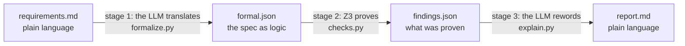
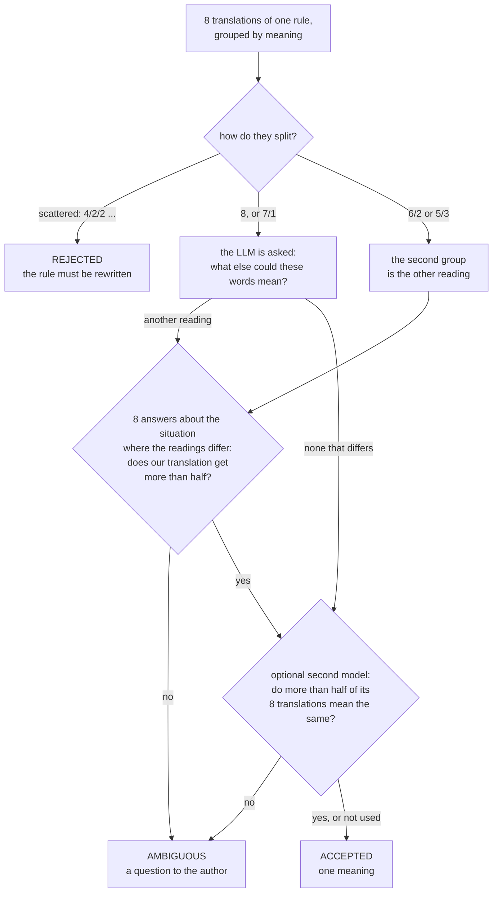
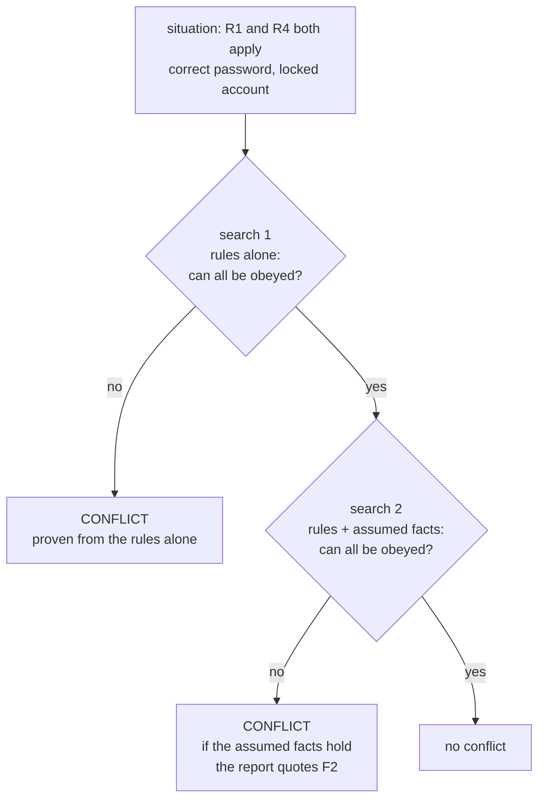

# speccheck: a guided tour

Read this first. It builds the project one idea at a time, each from an
example, and ends with what to open next. About 20 minutes.

| Part | What you get |
|---|---|
| [0](#0-the-whole-project-on-one-screen) | the whole project on one screen |
| [1](#1-two-things-to-learn-first) | how to read a formula, and what the Z3 solver does |
| [2](#2-the-basic-pipeline-on-one-small-spec) | the basic pipeline, on a spec of 5 rules |
| [3](#3-four-ways-the-translation-goes-wrong-and-the-four-repairs) | the four things that go wrong, and the repair for each |
| [4](#4-how-sure-is-a-finding) | how much to trust a finding |
| [5](#5-where-we-are) | how we measure, the results, the limits, what is next |
| [6](#6-what-to-open-next) | what to run and read, in order; a mini glossary |

---

## 0. The whole project on one screen

**The problem.** Requirements written in plain language can

- contradict each other: "backorder the order" and "never backorder"
- leave a case out: nothing says what happens when no order is submitted
- be read in two ways: "reaches 5" = exactly 5, or 5 or more?

People notice late, when the code is already written.

**The idea** (from the [Kiro blog](https://kiro.dev/blog/deep-spec-analysis/)):
an LLM translates the requirements into logic, and a solver *proves* what is
wrong with the logic.



**Who does what**

| | Its job | Can it be wrong? |
|---|---|---|
| the LLM | translates text into logic (stage 1), rewords the results (stage 3) | yes |
| Z3, the solver | proves every conflict, gap and scenario (stage 2) | no, not about the formulas it was given |
| our Python code | decides which questions Z3 gets; counts, votes, groups | (it is tested: 36 tests) |

**The one sentence to keep.** Z3 is never wrong about the formulas, but the
formulas come from an LLM. So most of the project is about one question:
*can we trust the translation, and when we cannot, do we say so?*

**What was built.** The formal part of Kiro's analysis as a minimal prototype:
about 2,400 lines of Python (half of them comments and prompts), one local
model (Qwen, 27B), measured on 171 spec versions. Results: part 5.

---

## 1. Two things to learn first

### 1.1 How to read a formula

Formulas are written in SMT-LIB: the operator comes first, inside the parentheses.

| You see | Read it as |
|---|---|
| `(and a b)` | a and b |
| `(not a)` | not a |
| `(=> a b)` | if a then b |
| `(= x 5)` , `(>= x 5)` | x is 5 , x is 5 or more |
| `(xor a b)` | exactly one of a and b is true |

Read from the inside out:

```
(=> (and order_submitted (not inventory_available)) order_on_backorder)
     └──────────── if this ─────────────────────┘   └── then this ──┘

"if an order is submitted and inventory is not available, the order is on backorder"
```

**One trap.** `(=> a b)` is true whenever `a` is false. "If it rains, I take
an umbrella" is not broken on a sunny day. Keep this in mind for 2.3.

### 1.2 What Z3 does: it answers one kind of question

> "Is there a situation in which all these formulas hold?"

- **yes** ("satisfiable"), and Z3 gives one such situation
- **no** ("unsatisfiable"): proven, no such situation exists

A *situation* is one value for every symbol, a snapshot:
`order_submitted = true, inventory_available = false, ...`

That is all Z3 does. Looping, counting, voting and grouping is our code.

**The trick used everywhere: to prove something, ask Z3 for a counterexample.**
If Z3 proves there is none, the thing is true.

| We want to know | We ask Z3 for a situation where... | Z3 says "there is none" → |
|---|---|---|
| do formulas T1 and T2 mean the same? | one holds and the other does not: `(xor T1 T2)` | they mean the same |
| does fact F follow from facts G? | G holds and F does not: `(and G (not F))` | F follows from G |
| can the rules be obeyed in situation S? | S holds and every rule holds | they cannot: a **conflict** |

When Z3 says "yes" instead, the situation it gives is the example shown to the
person. The docs call it the *witness*; in the JSON files it is the field `when`.

---

## 2. The basic pipeline, on one small spec

`specs/order/requirements.md`, the example of the Kiro blog:

```
R1: WHEN an order is submitted AND inventory is available, THE Order System SHALL fulfill the order.
R2: WHEN an order is submitted AND inventory is unavailable, THE Order System SHALL place the order on backorder.
R3: THE Order System SHALL NOT place any order on backorder.
R4: WHEN an order is canceled, THE Order System SHALL refund all associated payments.
R5: WHILE an order is in a canceled-and-refunded state, THE Order System SHALL NOT fulfill the order.
```

### 2.1 Stage 1: the LLM translates (`formal.json`)

It picks **symbols**, one named variable for each fact the text talks about:

```
order_submitted        yes/no    "An order has been submitted by a customer."
inventory_available    yes/no    "The inventory for the ordered items is available."
order_on_backorder     yes/no    "The order system has placed the order on backorder."
...                    (7 in all)
```

and writes every requirement as a **rule**: *when* it applies (antecedent),
and *what* must hold then (consequent).

| Rule | when (antecedent) | then (consequent) |
|---|---|---|
| R1 | `(and order_submitted inventory_available)` | `order_fulfilled` |
| R2 | `(and order_submitted (not inventory_available))` | `order_on_backorder` |
| R3 | `true` (always) | `(not order_on_backorder)` |
| R4 | `order_canceled` | `payments_refunded` |
| R5 | `order_canceled_and_refunded` | `(not order_fulfilled)` |

A rule means `(=> antecedent consequent)`.

### 2.2 Stage 2: Z3 looks for three kinds of situation (`findings.json`)

| Finding | It says | In the order spec |
|---|---|---|
| **conflict** | here the rules cannot all be obeyed | an order is submitted, no stock: R2 says backorder, R3 says never |
| **gap** | here no rule applies | no order submitted, none canceled: what must the system do? |
| **scenario** | the rules allow this. Was it meant? | an order is fulfilled although none was submitted |

(The fourth kind of finding, the *ambiguity*, comes in 3.1.)

### 2.3 The first hard idea: why the check "forces rules to apply"

The obvious question is "can all 5 rules hold together?". Z3's answer:

```
yes:  order_submitted = false, order_canceled = false, everything else false
```

Nothing happens, so every "if ... then" is obeyed (the trap of 1.1). The
answer is correct and useless.

So the check picks a rule (or 2, or 3 rules) and **forces** it to apply:

```
1. can R2 apply?                       (and order_submitted (not inventory_available))
   Z3: yes                             → the situation can happen

2. in that situation, can all          the situation + R1 ... R5
   rules be obeyed?
   Z3: no, proven                      → CONFLICT
```

Why "no": in that situation only one thing is left to choose, and neither choice works.

| `order_on_backorder` | R2 "backorder it" | R3 "never backorder" |
|---|---|---|
| true | obeyed | **broken** |
| false | **broken** | obeyed |

Z3 also names the rules it needed for the contradiction (here R2 and R3), and
our code shrinks that list until no rule can be dropped.

The other two findings use the same kind of question:

```
gap        a situation where NO rule applies
           (and (not A1) (not A2) (not A4) (not A5))        A = antecedent; R3 always
           Z3: yes → order_submitted = false,               applies, so it is left out
                     order_canceled = false, ...

scenario   all rules hold, R1 does NOT apply, and R1's outcome happens anyway
           Z3: yes → order_fulfilled = true, order_submitted = false
           allowed, because R1 says "when", not "only when"
```

Gap or scenario? A **gap**: the spec says nothing about the situation. A
**scenario**: the spec does decide it (allowed, or impossible), maybe not as meant.

### 2.4 Stage 3: the LLM rewords (`report.md`)

> **1. Conflict: Backorder Requirement Conflict**
>
> [...] In the situation where an order is submitted but inventory is
> unavailable, R2 requires the system to place the order on backorder, while
> R3 explicitly forbids the system from placing any order on backorder.
>
> - **A) Keep as-is:** [...]
> - **B) Change:** Remove R3 or modify it [...]
>
> *Proven:* Requirements R2, R3 cannot all be obeyed in this situation:
> - FALSE: inventory_available
> - TRUE: order_submitted

- the LLM only rewords: it cannot change the finding
- the `Proven:` lines are the exact fact from Z3, printed so you can check the wording against it

### 2.5 Try it now (no GPU, 1 second)

`formal.json` is saved in the repo, so stages 2 and 3 run without the LLM:

```
python -m speccheck specs/order/requirements.md --formal specs/order/formal.json --out out
python -m pytest tests
```

And Z3 itself, by hand. Start `python` in the project folder and paste:

```python
import json
from speccheck.logic import Vocabulary

formal = json.load(open("specs/order/formal.json", encoding="utf-8"))
vocab = Vocabulary(formal["symbols"])                    # symbols -> Z3 variables
R = {r["id"]: vocab.rule(r) for r in formal["rules"]}    # rules   -> Z3 formulas
all_rules = [r.formula for r in R.values()]

vocab.model(all_rules)                    # a situation: all rules hold when nothing happens
situation = [R["R2"].antecedent]          # force R2 to apply
vocab.model(situation)                    # a situation: it can happen
vocab.impossible(situation + all_rules)   # True: no way to obey all rules there
```

`vocab.model` = "give me a situation", `vocab.impossible` = "prove there is none".
The whole solver stage is built from these two calls.

---

## 3. Four ways the translation goes wrong, and the four repairs

Part 2 is the easy third of the project. The rest exists because the LLM's
translation can be wrong, and Z3 then proves the wrong thing.

| # | What goes wrong | Example | The repair | In the report |
|---|---|---|---|---|
| 1 | a sentence has two meanings, the LLM silently picks one | "reaches 5": exactly 5, or 5 or more? | the ambiguity check (3.1) | an **Ambiguity**: a question to the author |
| 2 | two rules say opposite things in different words, Z3 sees unrelated symbols | "grant access" / "deny access" | assumed facts and links (3.2) | "Conflict (**if the assumed facts hold**)" |
| 3 | the logic has no time, only one snapshot, so fake conflicts appear | two events "at the same moment" | the doubtful mark (3.3) | "Conflict (**doubtful**: ...)" |
| 4 | another run picks other symbols and gives other findings | a conflict found in one run, missed in the next | several symbol sets (3.4) | "**found with 3 of 3** symbol sets" |

### 3.1 Repair 1: does a rule have only one meaning? (ambiguity)

**Example** (`specs/auth_openspec`, rule R3): "WHEN the number of failed
attempts on an account reaches 5 THEN the system locks the account"

```
reading A   exactly 5      (=> (= failed_attempts 5)  account_locked)
reading B   5 or more      (=> (>= failed_attempts 5) account_locked)

they differ at:  failed_attempts = 6, account_locked = false      (Z3 finds this)
                 A: fine, the rule says nothing about 6      B: broken
```

Three detectors, each catching what the one before misses:



1. **Samples** (`formalize.py`, steps 2 and 3)
   - the LLM translates the rule 8 times, independently
   - our code groups the 8 by meaning: two go together when Z3 proves
     `(xor T1 T2)` has no situation
   - weakness: one model makes the same choice 8 times. Real case: R3 split
     7/1, which counts as "they agree"
2. **Questions** (`probe.py`)
   - the LLM proposes other readings → B
   - Z3 finds the situation where A and B differ → 6 attempts, not locked
   - the LLM is asked 8 times: "do the words say A, B, or either?"
   - real case: 1 answer for A, 6 for B → A did not get more than half → **ambiguous**
3. **A second model** (optional, `formalize.py` step 7)
   - a model of another family translates the rule 8 times
   - at most half mean the same as A → **ambiguous**
   - why: where the words are unclear, a different model hesitates or picks the other reading

The result in the report is a question, not a verdict (real output):

> **1. Ambiguity: Ambiguity in lock threshold**
>
> Requirement R3 is unclear about whether the account should be locked when
> the failed attempt count is exactly 5 or when it is 5 or more. [...] Which
> did you mean?

### 3.2 Repair 2: tell the solver what the words mean (assumed facts, links)

**Example** (`specs/auth_openspec`):

```
R1  "WHEN a user submits a correct password THEN the system grants access"
    (=> (and password_submitted password_correct) access_granted)

R4  "WHEN a user submits a password for a locked account THEN the system denies access"
    (=> (and password_submitted account_locked) access_denied)
```

A person sees the clash: a correct password for a locked account. Z3 does not.
For Z3, `access_granted` and `access_denied` are two unrelated yes/no values.
Asked about that situation, it answers:

```
access_granted = true, access_denied = true        both rules obeyed, no conflict
```

**Repair A: voted facts** (`formalize.py`, step 4)

1. The LLM gets **only the symbols with their meaning**, not the requirements,
   and lists what is true "purely because of what the symbols mean". 8 times.
   ```
   F2   "The system cannot grant access and deny access simultaneously."
        (not (and access_granted access_denied))
   ```
2. Vote. The 8 answers word the same fact differently, so the vote is done by
   logic: an answer agrees with F2 when F2 *follows* from that answer's facts
   (the counterexample trick of 1.2). F2: 7 of 8 → kept (more than half).
3. The conflict search runs twice:



**Why "add only"?** A fact is the LLM's guess, and a guess can be wrong:

- once, 7 of 8 answers agreed that "an order cannot be both fulfilled and
  canceled". That is a business rule, not a fact
- used as a truth, it made a real conflict of the order spec disappear
- so now: search 1 never sees the facts. A fact can add a conflict (marked,
  and quoted), and it can never remove one

**Repair B: links** (`formalize.py`, step 5), for a symbol only one rule uses

```
D2  "... SHALL remove the Property record from the Platform"
D4  "... soft deletion to retain Property records in the database ..."
                                                   (specs/delete_property)

D2:  deletion_confirmed ──► property_record_removed          no other rule uses this symbol
                                 │
                                 │  link, 8 of 8 answers: "removed" means "not retained"
                                 ▼
D4:  (its condition) ─────► property_record_retained_in_db   ✗ the clash, now visible to Z3
```

- the rule is translated 8 more times, and the LLM may use only the
  **outcomes of the other rules**. For D2: "the record is not retained in the database"
- more than half agree → the link becomes an assumed fact, add-only like the others
- before it is used, it is checked by a question (`probe.py`): "D2 is fully
  obeyed and the record is still in the database: possible?" Most answers
  must say "impossible"

### 3.3 Repair 3: mark the conflicts that are probably artefacts (doubtful)

A situation is one snapshot. There is no "before" and "after". That gives two
kinds of fake conflict:

**Two events at the same moment**

```
rule 1      "WHEN a visitor submits the signup form THEN the system sends no email ..."
rule 2      "WHEN a subscriber changes the email address THEN the system sends a confirmation email"

situation   visitor_signed_up = true, address_changed = true
            → "no email" against "an email" → conflict
```

- nobody writes requirements for two events in the same instant
- the LLM names, for each rule, the event it reacts to (its *trigger*)
- the clashing rules react to two different events → **doubtful**

**A situation the facts call impossible**

```
"cancels at least 24 hours before" → no fee        "less than 24 hours before" → a late fee

situation   at_least_24h = true, less_than_24h = true     → no fee and a late fee → conflict
fact        (not (and at_least_24h less_than_24h))        → this cannot happen → doubtful
```

A doubtful conflict **stays in the report, marked**. It is not removed,
because the mark has also hit real conflicts that we had planted.

### 3.4 Repair 4: do the findings depend on the symbols? (symbol sets)

- the LLM chooses the symbols once, at the start, and everything follows from that choice
- another run may choose other symbols, and find other things
- `--symbol-sets 3` → the spec is formalized 3 times, and each finding says
  with how many of the 3 it was found:

> **3. Conflict (found with 3 of 3 symbol sets): Conflict between removal and retention**

### 3.5 Now the seven steps of stage 1 make sense

| Step in `formalize.py` | What happens | Needed for |
|---|---|---|
| 1 read | 1 LLM call: the rules, the symbols, each rule's trigger | everything; triggers for 3.3 |
| 2 sample | each rule translated 8 times | 3.1 |
| 3 cluster | the 8 grouped by meaning, with Z3 | 3.1 |
| 4 facts | 8 answers, voted with Z3 | 3.2 |
| 5 links | rules with a symbol of their own, said again in the others' terms | 3.2 |
| 6 probe | questions about concrete situations (`probe.py`) | 3.1 and 3.2 |
| 7 second | optional: a second model translates every rule | 3.1 |

---

## 4. How sure is a finding?

The title of each finding says it.

| The title says | What it means | Trust |
|---|---|---|
| "Conflict: ..." | proven from the rules alone | high. Wrong only if the translation is wrong |
| "Conflict (if the assumed facts hold): ..." | proven only with a guessed fact, which the report quotes | read the quoted fact and judge it |
| "Conflict (doubtful: ...)" | proven, but it has the shape of an artefact (3.3) | low. In the evaluation nearly all were false alarms |
| "... (found with k of K symbol sets)" | found with k of the K formalizations | the higher k, the better |
| "Ambiguity: ..." | not a proof: a question to the author | a real question; some are asked about clear rules |
| "Gap: ..." | proven: no rule applies there | proven, but often trivial ("nothing is happening") |
| "Scenario, allowed / ruled out: ..." | proven; an LLM judge only chose which ones to show | proven. Whether it matters is an opinion |

One sentence: **a finding is a proof about `formal.json`, not about what the
author meant.** If a finding looks wrong, open `formal.json` and read how that
rule was translated.

---

## 5. Where we are

### 5.1 How we measure (needed to read the numbers)

- **Planted defect**: take a clean spec and add one defect by hand, so the
  right answer is known.
  ```
  experiments/sets/eval4/lockers_clean      5 rules, no defect
  experiments/sets/eval4/lockers_overlap    + rule 6: "WHEN the locker is in maintenance mode
                                              THEN the system opens no compartment"
                                              → must clash with rule 1 and rule 3 (both open a compartment)
  experiments/sets/eval4/lockers_ambiguity1 rule 5 reworded: "for more than 72 hours"
                                              → "is still in its compartment after 72 hours"
  ```
- **False alarm**: a conflict reported on a clean spec.
- **Run**: the pipeline once on one spec. The LLM answers differently each
  time, so every number is "in how many runs". 3 runs per spec.
- **Held-out set**: a set of specs written *before* a design change and used
  once, as an exam. After its results are read it becomes practice material.
  That is why there are 7 sets (`eval` to `eval7`): 7 rounds, each with a
  fresh exam.

### 5.2 The results

```
planted conflicts found, on 7 sets the design had not seen

eval    44/48   ██████████████████░░   92%
eval2   31/36   █████████████████░░░   86%
eval3   15/21   ██████████████░░░░░░   71%
eval4   21/21   ████████████████████  100%
eval5   11/18   ████████████░░░░░░░░   61%
eval6   15/18   █████████████████░░░   83%
eval7   13/18   ██████████████░░░░░░   72%
```

| Question | Answer |
|---|---|
| Kiro's first example (`order`) | its 2 conflicts and its gap: found in 190 of 190 runs |
| Kiro's second example (`delete_property`) | found in 3 of 3 of the last runs. It was the hard one: 1 of 40 before links, and it broke twice after prompt changes |
| planted conflicts | 61% to 100% found (above) |
| false alarms | at most 1 in 18 clean runs, with doubtful conflicts set aside |
| planted ambiguities, one model | about half (14 to 19 of 36) |
| planted ambiguities, with the second model | 30 and 32 of 36, at the price of up to one extra question per spec |
| how much assumed facts and links matter | a lot: without them `eval7` gives 3 of 18, with them 13 |

### 5.3 The goals

| Goal | Status |
|---|---|
| G1 a minimal working prototype of Kiro's formal analysis | done |
| G2 works on any spec, any format | partly: 2 formats, 45 specs. Missing: a whole OpenSpec project (below) |
| G3 code and documents a person can read | done for the current state |
| G4 research for a paper, on a local model | well under way; the evaluation is still small |
| G5 only the formal part | done: an LLM review of the text was built, measured, and switched off |

### 5.4 What does not work yet

| Limit | Example |
|---|---|
| "remove" against "keep" is missed in about half of the cases | "delete the listing" vs "keep every listing for seven years" becomes a number, `retention_years = 7`, and nothing clashes with "deleted". The main cause of missed conflicts |
| one model finds only half of the ambiguities | it is confident where a person would ask |
| a fact or a link can be wrong, even with a majority | so the report quotes every one a conflict depends on |
| no time | "then", "after", "until" are not modelled: one snapshot |
| the evaluation is small | specs written by us, one main model |

### 5.5 What we tried and dropped (the three that teach the most)

| Tried | What happened |
|---|---|
| facts as hard truths | a wrong fact with 7 of 8 votes hid a real conflict → facts became add-only |
| an LLM review of the text (`refine.py`) | it finds `delete_property` every time and misses two conflicts the solver finds; it is a judgement, not a proof → switched off (`--review`): the project is about the formal check |
| fixing "remove / keep" with one more prompt sentence | it made things worse → left as a documented limit |

The full list is in research.md, section 5.

### 5.6 What is next

1. **Check a change against the specs that already exist** (an OpenSpec
   project: existing specs + a change). Recommended, and postponed by decision.
2. **A larger evaluation**: more runs, another main model. All 7 sets are used
   up, so an 8th must be written first.
3. **The choice of symbols**: where the remaining misses come from.

---

## 6. What to open next

**Run first** (2.5): the two commands, then the Python snippet.

**Then look at one spec in its four forms**, side by side:

```
specs/order/requirements.md   the text
specs/order/formal.json       the logic              (stage 1)
specs/order/findings.json     what was proven        (stage 2)
specs/order/report.md         the plain language     (stage 3)
```

- `specs/auth_openspec/` next: it has the ambiguity of 3.1 and the assumed fact of 3.2
- for `delete_property`, open `experiments/examples/delete_property_links/`
  (3 symbol sets, the conflict of 3.2 and 3.4). The run saved in
  `specs/delete_property/` is one of the runs that **miss** that conflict: its
  D4 was translated 4 different ways and rejected

**Then the documents**

| File | Read it for | When |
|---|---|---|
| [README.md](README.md) | the same story, denser, with more real output; how to run with the LLM | next. Start at "A) The request: a spec"; go back to "The project in one minute" at the end, as a summary |
| [plan.md](plan.md) | section 5: the exact rule behind each decision; section 6: every JSON field | when you read the code |
| [research.md](research.md) | every result, with its numbers | when you want to know what is measured |
| [research_log.md](research_log.md) | the archive: every experiment in the order it happened | only for writing the paper |

**Then the code**, in this order:

| File | Lines | What to look for |
|---|---|---|
| `speccheck/llm.py` | 60 | one function, `ask`: a prompt in, N answers in JSON out |
| `speccheck/logic.py` | 220 | `model` and `impossible`: the two questions for Z3 (1.2) |
| `speccheck/checks.py` | 520 | `_search`: forcing rules to apply (2.3); `find_conflicts`: the two searches (3.2); `find_gaps`; `find_scenarios` |
| `speccheck/formalize.py` | 690 | the 7 steps of 3.5. The prompts at the top say what the LLM is asked |
| `speccheck/probe.py` | 430 | the questions about concrete situations (3.1, 3.2) |
| `speccheck/explain.py` | 330 | `evidence`: the `Proven:` lines; the wording prompt |
| `speccheck/cli.py` | 110 | the three stages, called one after the other |

About half of each file is comments, docstrings and prompts.

**The folders**

```
speccheck/          the tool (7 files above; refine.py is the switched-off review)
specs/              3 small specs the prompts were developed on, with their saved output
tests/              36 tests, no LLM needed
experiments/
  sets/             the 7 evaluation sets: eval ... eval7 (171 spec versions)
  results/          every experiment: raw data (.json) and tables (.md)
  examples/         saved runs that the documents quote
  evaluate.py       runs the pipeline on a set and scores it
  make_eval.py      writes the evaluation sets
  slurm/            starts the model servers on the cluster
```

### Mini glossary

| Term | In one line | Example |
|---|---|---|
| symbol | a named variable for one fact | `inventory_available` |
| situation | a value for every symbol: one snapshot | `order_submitted = true, inventory_available = false` |
| rule | one requirement in logic: antecedent ⇒ consequent | R2 in 2.1 |
| antecedent / consequent | when the rule applies / what must hold then | `order_canceled` / `payments_refunded` |
| translation, reading | one LLM answer that writes a rule in logic / one meaning of the words | "exactly 5" and "5 or more" are two readings |
| sample | one of 8 independent LLM answers to the same question | 8 translations of R3 |
| witness (`when`) | the situation Z3 gives as the example | "an order is submitted, no stock" |
| assumed fact | true by the meaning of the words, guessed by the LLM, add-only | "access cannot be granted and denied" |
| link | an assumed fact that says one rule in the other rules' terms | "removed means not retained" |
| event / trigger | something that happens at one moment / the event a rule reacts to | `order_submitted` |
| doubtful | a proven conflict that looks like an artefact | two events at once |
| symbol set | the symbols of one formalization | `--symbol-sets 3` |
| formal model | one `formal.json`: symbols + assumed facts + rules | `specs/order/formal.json` |
